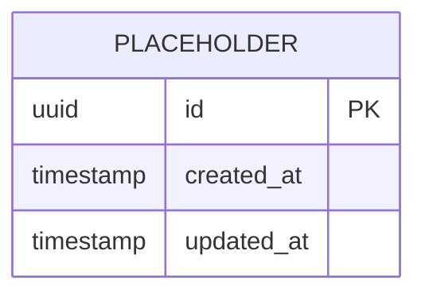

# Database Schema

> Status: Draft — PostgreSQL/PostGIS and core persistence tooling are approved; the domain schema remains undesigned.

## 1. Data Design Principles

- Model the approved domain, not hypothetical future features.
- Use stable identifiers and explicit ownership boundaries.
- Enforce integrity with constraints in addition to application validation.
- Store timestamps consistently (prefer UTC) and document precision.
- Classify sensitive data and minimize its collection.
- Design migrations to be reversible or provide a tested recovery procedure.

## 2. Data Classification and Lifecycle

| Data category | Examples | Classification | Retention | Deletion/export rule |
|---|---|---|---|---|
| TBD | TBD | Public/Internal/Confidential/Restricted | TBD | TBD |

## 3. Entity Relationship Overview

Replace the placeholder only after requirements identify the core entities.

## 4. Table Definitions

### `placeholder` (remove when the real schema is defined)

| Column | Type | Null | Default | Constraints | Description |
|---|---|---:|---|---|---|
| `id` | UUID/TBD | No | Generated | Primary key | Stable identifier |
| `created_at` | Timestamp/TBD | No | Current time | — | Creation time in UTC |
| `updated_at` | Timestamp/TBD | No | Current time | — | Last update time in UTC |

## 5. Relationships and Delete Behavior

| Parent | Child | Cardinality | On delete | Reason |
|---|---|---|---|---|
| TBD | TBD | TBD | Restrict/Cascade/Soft delete | TBD |

## 6. Indexes and Access Patterns

Indexes must follow measured or clearly expected access patterns.

| Table | Query/access pattern | Index | Unique | Notes |
|---|---|---|---:|---|
| TBD | TBD | TBD | No | TBD |

## 7. Authorization and Tenant Isolation

- Ownership model: TBD
- Tenant boundary: TBD
- Row-level access strategy: TBD
- Administrative access/auditing: TBD

## 8. Migration Strategy

- Tool: Alembic with reviewed committed revisions (`DECISIONS.md`, DEC-023).
- Execution: One controlled deployment/release job; never automatic per API/Worker replica.
- History: Do not edit an applied shared-environment migration; add a corrective revision. Maintain one head by default.
- Compatibility: Use expand-and-contract when application versions may overlap; exact support window is TBD.
- Backfills: Separate large backfills where practical and make them bounded, observable, idempotent/resumable, and safe to pause.
- Rollback/recovery: Prefer corrective forward migrations; use downgrade only when genuinely safe. Require backup/recovery planning for destructive or high-risk changes.
- Tests: Upgrade an empty database and the previous supported PostgreSQL/PostGIS schema; check heads, drift, spatial operations, locks, and affected data.
- Naming/version convention, timeout values, backup mechanism, and exact CI commands: TBD.

## 9. Backup and Recovery

- Backup cadence: TBD
- Retention: TBD
- Recovery point objective (RPO): TBD
- Recovery time objective (RTO): TBD
- Restore-test cadence: TBD

## 10. Open Questions

- [x] PostgreSQL with PostGIS is the authoritative datastore (`DECISIONS.md`, DEC-009).
- [ ] Which records contain personal or regulated data?
- [ ] Are soft deletion, audit history, or event history required?
- [ ] What are the expected data volume and growth rate?
