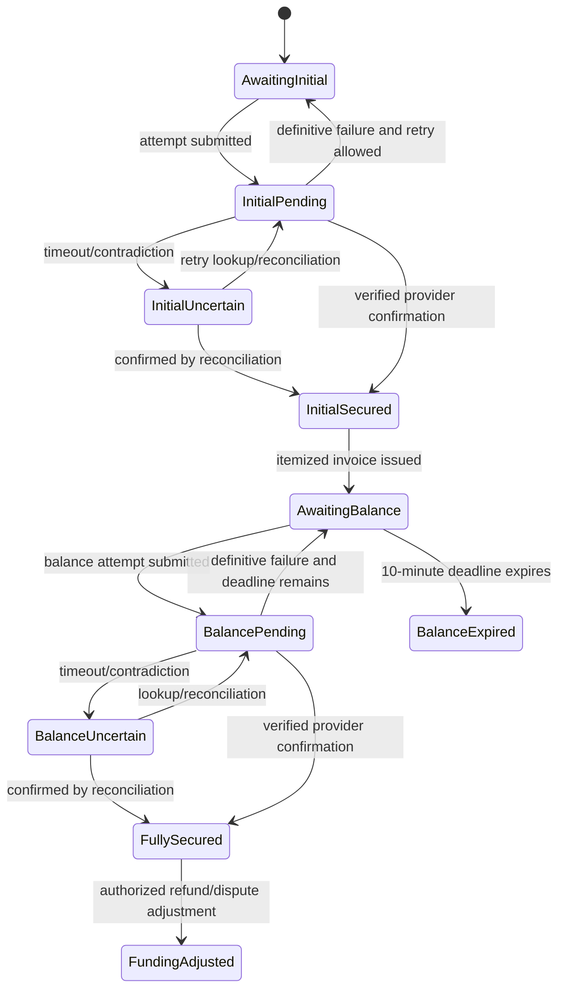

# Provider-Neutral Payment Domain Model

> Status: Product Owner product rules accepted under DEC-062; provider, legal, accounting, schema/API, and engineering validation remain open.
>
> This document proposes Kirim's internal payment language and controls without approving Stripe or another provider. `docs/REQUIREMENTS.md` and accepted records in `DECISIONS.md` remain authoritative. Items marked **OPEN** or **GATE** are not implementation decisions.

## 1. Purpose

Kirim needs a stable internal model for Customer funding, Shopper reimbursement, Shopper earnings, refunds, disputes, and settlement. That model must remain understandable even if the eventual provider uses different words or objects.

The model separates four concerns:

1. **Product workflow:** What Kirim permits the Customer, Shopper, and Support team to do.
2. **Payment state:** What Kirim currently knows about funding, refunds, and settlement.
3. **Financial journal:** The immutable explanation of expected and observed financial effects.
4. **Provider adapter:** The translation between Kirim operations and a selected provider's API/events.

A provider response never bypasses Kirim workflow or authorization rules. Kirim never invents provider success after a timeout, and a client screen never establishes payment truth.

## 2. Scope

### Included

- Initial Customer payment equal to the locked Shopper fee.
- Separately disclosed payment-processing costs.
- Itemized outstanding-balance funding.
- Customer-funding confirmation before Shopper purchase.
- Shopper personal advance at the merchant.
- Verified item-cost reimbursement.
- Locked Shopper-fee earnings.
- Cancellation allocations.
- Refunds and settlement.
- The 24-hour dispute window.
- Provider events, idempotency, retries, reconciliation, and uncertain outcomes.
- Human-authorized dispute adjustments.

### Excluded from this draft

- Final provider-specific object mapping.
- Legal classification of provider balances or custody.
- General-ledger, tax, SST, e-invoice, or statutory accounting conclusions.
- Kirim platform revenue, because MVP platform revenue is zero.
- Multi-currency, tips, promotions, credits, wallets, cash, subscriptions, split Shoppers, or multiple shops.
- A platform-issued purchasing card.

## 3. Requirement Traceability

| Requirement | Domain-model implication |
|---|---|
| FR-NEG-004 | Payment records belong only to an explicitly confirmed transaction with locked terms. |
| FR-PAY-001 | Initial Shopper-funds principal equals the locked Shopper fee; processing costs are separate and never Shopper funds. |
| FR-PAY-002 | Only an approved provider-confirmed state advances price collection or checkout. |
| FR-PAY-003 | Invoice components, prior payments, processing costs, and outstanding balance reconcile exactly once. |
| FR-PAY-004 | Outstanding-balance funding has a 10-minute deadline and expiry outcome. |
| FR-PAY-005 | Charge, refund, reimbursement, transfer, and payout commands are idempotent. |
| FR-PAY-006 | Pending, uncertain, failed, secured, refunded, disputed, reimbursed, transferred, and paid states remain distinguishable. |
| FR-PAY-007 | Normal settlement requires delivery + 24 hours + no open dispute; eligibility and reservation are atomic. |
| FR-SHP-003 | Checkout authorization is impossible until every required Customer-funding obligation is confirmed. |
| FR-SHP-004 | Shopper personal advance and maximum expected advance are explicit. |
| FR-SHP-005 | Receipt reconciliation is a settlement guard; material discrepancies require review. |
| FR-SHP-006 | Financial evidence and corrections are append-only or linked compensations. |
| FR-CAN-001 | Cancellation calculation uses verified state and responsible party. |
| FR-CAN-002 | Qualifying Customer cancellation/balance expiry allocates 50% of the locked Shopper fee to the Shopper. |
| FR-DSP-001 | Delivery disputes may be timely for 24 hours; late cases use a documented exception path. |
| FR-DSP-002 | An open dispute blocks affected automatic settlement. |
| FR-DSP-003 | MVP dispute outcomes are human-authorized. |
| FR-ADM-002 | Every consequential adjustment records actor, reason, case, evidence, and effect. |
| FR-ADM-003 | Refund/reimbursement/payout actions require authorization and compatible state. |
| Payment reliability NFR | Ambiguous provider outcomes remain pending/uncertain and are reconciled. |
| Auditability NFR | Financial events are attributable, timestamped, immutable/tamper-evident, and retained by policy. |
| Recovery NFR | Restored Kirim financial state is reconciled against provider records. |

## 4. Core Terminology

| Term | Meaning in Kirim | Important boundary |
|---|---|---|
| Locked Shopper fee | Final Customer-confirmed compensation amount for the Shopper | Cannot be changed silently after final confirmation |
| Processing cost | Provider/payment-method cost disclosed to and paid by the Customer where permitted | Never counted as Shopper reimbursement or earnings |
| Funding obligation | Amount the Customer must successfully fund for a named stage | Separate from an API attempt or provider object |
| Funding attempt | One idempotent effort to satisfy a funding obligation | Multiple attempts may exist; financial effect must not duplicate |
| Provider-confirmed funds | A normalized provider state that the approved contract says is sufficient for the next Kirim action | Exact provider state is a GATE, not assumed by this document |
| Secured | Kirim shorthand for a funding obligation that reached the approved provider-confirmed state | Must not be marketed as escrow or guaranteed funds without approval |
| Item principal | Sum of Customer-approved item prices included in the final invoice | Maximum requested-item budget is RM200 |
| Shopper personal advance | Money the Shopper pays directly to the merchant | Kirim does not treat this as Customer payment to the merchant |
| Reimbursement | Amount payable to restore the verified eligible item cost advanced by the Shopper | Separate from earnings in the journal and user statement |
| Earnings | Locked Shopper fee or approved cancellation compensation payable to the Shopper | Not reimbursement |
| Settlement obligation | Kirim's approved amount payable to the Shopper, composed of reimbursement and/or earnings | May map to one provider transfer but remains componentized internally |
| Transfer | Provider movement from the platform-side funds arrangement to the connected Shopper account | Not automatically equal to bank payout |
| Payout | Provider movement from a connected account/balance to the Shopper's bank | Exact “paid” user wording remains a GATE |
| Refund | Amount returned or due to the Customer through the provider | May be full or partial and may exclude provider costs only when approved |
| Internal dispute | Kirim delivery/failed-delivery dispute | Different from a card/payment-network dispute or chargeback |
| Provider dispute | Chargeback/payment-method dispute administered through the provider/network | May arise after Kirim has settled the Shopper |
| Reconciliation | Comparison of Kirim intents/journal/state with authoritative provider records | Required after uncertainty, recovery, and on a schedule |
| Compensating journal | New immutable journal that corrects/reverses a prior effect | Original journals are never edited or deleted |

## 5. Modeling Principles

1. **Use integer minor units.** Store MYR amounts as integer sen; never use binary floating point for authoritative calculations.
2. **One currency per MVP transaction.** Currency is `MYR`; mixed-currency transactions are rejected.
3. **Separate obligation, attempt, and result.** A retry creates or reuses an attempt; it does not create another obligation.
4. **Separate product state from provider state.** Stripe-like object statuses never become the transaction state machine directly.
5. **Separate reimbursement from earnings.** They may share a transfer but never lose their component identity.
6. **Append, do not rewrite.** Corrections use compensating journals and linked audit events.
7. **Provider success requires verification.** Client callbacks, redirects, screenshots, push notifications, and unverified webhooks are not authoritative.
8. **Unknown is not failure.** A timeout after a request may mean success; block unsafe retry until lookup/reconciliation resolves it.
9. **At-least-once messages, exactly-once financial intent.** Workers/webhooks may repeat; unique semantic operation keys prevent duplicate effects.
10. **Atomic eligibility.** Settlement reservation and the deadline/dispute/state checks happen in one database transaction.
11. **Fail closed for purchase and settlement.** Missing, stale, contradictory, or unreconciled payment evidence cannot authorize purchase or release.
12. **No provider lock-in in domain code.** Provider-specific IDs and payloads stay behind adapter/mapping boundaries.

## 6. Proposed Domain Objects

### 6.1 `PaymentProfileReference`

A Kirim reference to the user's approved provider-side Customer or connected-account identity.

Proposed fields:

- `user_id`
- `provider_key`
- `provider_customer_reference` or connected-account reference
- capability/onboarding status snapshot
- verification timestamp
- disabled/restricted reason category
- created/updated timestamps

Never store raw bank/card credentials in Kirim.

### 6.2 `FundingObligation`

Represents what the Customer must fund for one stage.

Proposed fields:

- `id`
- `transaction_id`
- `kind`: `INITIAL_SHOPPER_FEE` or `OUTSTANDING_BALANCE`
- `currency`
- `principal_amount_minor`
- `processing_cost_amount_minor` when known/approved
- `total_customer_due_minor`
- `status`
- `due_at`
- immutable calculation/version reference
- created/satisfied/expired timestamps

### 6.3 `FundingAttempt`

Represents one provider-facing effort to satisfy an obligation.

Proposed fields:

- `id`
- `funding_obligation_id`
- semantic operation key
- client idempotency key and request fingerprint
- provider key/reference
- normalized status
- provider-status snapshot
- action-required metadata safe for the client
- attempt number
- requested/confirmed amount and currency
- created/last-checked/confirmed timestamps
- uncertainty/reconciliation reason

### 6.4 `ItemizedInvoice`

An immutable versioned calculation of the final approved Customer amount.

Proposed fields:

- approved item-line snapshots and prices
- item principal
- locked Shopper fee
- separately disclosed processing costs
- initial principal already funded
- processing costs already paid
- outstanding principal
- outstanding processing cost
- total outstanding Customer due
- calculation version and generated timestamp

A corrected invoice creates a new version and links to the prior version; it does not rewrite a funded invoice silently.

### 6.5 `SettlementObligation`

Represents the approved amount payable to the Shopper.

Proposed fields:

- `id`
- `transaction_id`
- `currency`
- `reimbursement_amount_minor`
- `earnings_amount_minor`
- `total_amount_minor`
- eligibility status and eligible-at time
- blocking reasons
- source receipt/reconciliation version
- source cancellation/dispute/support decision
- status
- reserved/approved timestamps

### 6.6 `SettlementAttempt`

Represents a provider transfer/payout operation without assuming the two are identical.

Proposed fields:

- settlement obligation
- semantic operation key
- provider transfer reference
- provider payout reference when available
- normalized transfer status
- normalized payout status
- requested/confirmed/failed timestamps
- uncertainty/reconciliation reason

### 6.7 `RefundObligation` and `RefundAttempt`

Mirror the obligation/attempt separation for Customer refunds.

The obligation records why and how much must be returned. Attempts record provider calls/results. One obligation may require multiple provider refunds if the Customer funded through multiple payment objects.

### 6.8 `ProviderEventInbox`

Durable deduplicating storage for verified provider events.

Proposed fields:

- provider key
- provider event ID with uniqueness constraint
- event type/version
- provider object reference
- provider occurred-at and Kirim received-at timestamps
- signature verification result
- payload hash
- minimal encrypted/raw payload retention reference where approved
- processing status, attempts, last error, processed timestamp

### 6.9 `FinancialJournal` and `FinancialPosting`

Immutable transaction-level financial explanation. See Section 10.

## 7. Funding State Model

Kirim should model funding obligations separately from the overall transaction.

### 7.1 Normalized funding-attempt states

| State | Meaning | May authorize next workflow step? |
|---|---|---:|
| `CREATED` | Attempt recorded locally but not yet submitted | No |
| `SUBMITTING` | Provider call is in progress | No |
| `ACTION_REQUIRED` | Customer/provider interaction is required | No |
| `PROVIDER_PENDING` | Provider accepted but has not reached the approved secured state | No |
| `CONFIRMED` | Verified provider state satisfies the approved secured criterion | Yes, only after obligation/transaction checks |
| `DECLINED` | Provider definitively rejected the attempt | No |
| `CANCELED` | Attempt definitively canceled without confirmed funds | No |
| `EXPIRED` | Attempt/deadline is no longer usable | No |
| `UNCERTAIN` | Request may have succeeded but result is unknown | No; lookup/reconciliation required |
| `RECONCILIATION_REQUIRED` | Local/provider evidence is contradictory or incomplete | No |

`CONFIRMED` is a Kirim-normalized state. The selected provider contract must define which provider status/events qualify.

### 7.2 Overall transaction-funding states



Cancellation/transaction closure can terminate a branch, but it must not erase confirmed funding or the obligation to refund/allocate it.

### 7.3 Funding guards

Price collection may begin only when:

- Final Customer confirmation and locked terms still exist.
- Initial obligation amount equals the locked Shopper fee principal.
- A verified attempt satisfies the initial obligation.
- No cancellation, security hold, or incompatible transaction state exists.

Checkout authorization may occur only when:

- Initial and outstanding-balance obligations are both satisfied.
- The current immutable invoice version matches the funded balance calculation.
- No payment attempt is uncertain or unreconciled.
- Required item approvals remain valid.
- The transaction is not canceled, disputed, security-held, or expired.

## 8. Invoice Calculation

All calculations use integer sen.

Proposed formula:

```text
item_principal
  = sum(approved item-line quantity × approved unit price)

transaction_principal
  = item_principal + locked_shopper_fee

principal_already_funded
  = confirmed initial Shopper-fee principal

outstanding_principal
  = transaction_principal - principal_already_funded

outstanding_customer_due
  = outstanding_principal
    + approved processing cost for the outstanding payment
```

Previously paid processing costs appear on the invoice for disclosure/reconciliation but are not subtracted from principal and are not counted as Shopper funds.

Required checks:

- `item_principal <= RM200` requested-item budget.
- `principal_already_funded == locked_shopper_fee` before the normal balance flow.
- No item line or processing cost is credited twice.
- Negative outstanding amounts are rejected and sent to review.
- Invoice version cannot change after balance confirmation except through an authorized compensating flow.
- Displayed MYR totals round only at approved input/calculation boundaries, never through binary floating point.

## 9. Settlement State Model

### 9.1 Settlement states

| State | Meaning |
|---|---|
| `NOT_YET_PAYABLE` | Purchase/delivery conditions are incomplete |
| `RECEIPT_REVIEW_REQUIRED` | Receipt discrepancy blocks automatic progression |
| `DISPUTE_WINDOW` | Delivery confirmed; 24-hour window has not ended |
| `BLOCKED_BY_DISPUTE` | Timely/open dispute blocks affected automatic release |
| `BLOCKED_BY_SECURITY` | Fraud, account, provider, or manual hold exists |
| `ELIGIBLE` | All guards pass and settlement may be reserved |
| `RESERVED` | One atomic Kirim settlement obligation has been created |
| `TRANSFER_PENDING` | Provider transfer request accepted/pending |
| `TRANSFER_UNCERTAIN` | Transfer may have occurred; reconciliation required |
| `TRANSFER_CONFIRMED` | Provider confirms transfer to the connected account/balance |
| `PAYOUT_PENDING` | Provider reports downstream bank payout pending where observable |
| `PAYOUT_CONFIRMED` | Provider reports bank payout success where observable |
| `FAILED_RETRYABLE` | No confirmed transfer effect and documented safe retry is allowed |
| `FAILED_PERMANENT` | Manual support/provider action is required |
| `REVERSED_OR_ADJUSTED` | Authorized compensation/reversal followed a prior settlement effect |

### 9.2 Eligibility and reservation

Settlement eligibility and reservation must occur in one database transaction. The operation verifies:

- Delivery is confirmed or an authorized support outcome permits settlement.
- Current time is at or after the authoritative `delivery_confirmed_at + 24 hours` deadline.
- No timely/open dispute blocks the affected amount.
- Receipt is readable and reconciled; no material discrepancy remains.
- Required Customer funding is confirmed and reconciled.
- Shopper account/capability is eligible to receive settlement.
- No account, transaction, fraud, security, provider, or pilot-pause hold applies.
- No existing settlement obligation/semantic operation already covers the same amount and purpose.
- Reimbursement equals the verified eligible receipt amount.
- Earnings equal the locked Shopper fee or an authorized cancellation/dispute amount.

A unique semantic key such as `transaction:{id}:normal-settlement:v1` prevents two reservations.

### 9.3 Settlement components

Kirim records separately:

```text
reimbursement component = verified eligible item cost
earnings component       = locked Shopper fee or authorized compensation
total settlement         = reimbursement + earnings
```

**APPROVED-PO-PAY-002:** preserve reimbursement and earnings as separate internal and user-statement components, while allowing one provider transfer for their total when supported. This reduces provider operations without confusing reimbursement and earnings.

## 10. Proposed Immutable Financial Journal

### 10.1 Purpose and boundary

This is a **Kirim domain subledger**, not a final statutory accounting chart. It explains transaction obligations and provider-observed effects. A Malaysian accountant must review account names, normal sides, recognition timing, and reporting before Stage B.

### 10.2 Journal structure

Each `FinancialJournal` contains:

- journal ID and type
- transaction ID
- immutable currency
- effective time and recorded time
- actor/source: system, provider event, Worker, or authorized Admin
- reason and requirement/workflow reference
- idempotency/semantic operation key
- provider object/event references
- `reversal_of_journal_id` or correction link where applicable
- one or more balanced postings
- audit/case/evidence references for consequential adjustments

Each posting contains:

- account code
- debit or credit direction
- positive integer minor-unit amount
- component/purpose metadata

For every journal:

```text
sum(debit postings) == sum(credit postings)
```

No journal or posting is updated/deleted after commit. Mistakes create a compensating journal.

### 10.3 Candidate domain accounts

These names are conceptual and require accounting review:

| Account | Purpose |
|---|---|
| `CUSTOMER_FUNDING_PENDING` | Provider operation requested but not confirmed; normally operational/memo rather than recognized funds |
| `PROVIDER_FUNDS_CONFIRMED` | Amount the provider confirms under the approved funds model |
| `CUSTOMER_FUNDING_APPLIED` | Confirmed principal allocated to the Kirim transaction |
| `CUSTOMER_REFUND_PAYABLE` | Approved principal due back to Customer |
| `CUSTOMER_REFUND_IN_FLIGHT` | Refund requested but not confirmed |
| `SHOPPER_REIMBURSEMENT_PAYABLE` | Verified item cost owed to Shopper |
| `SHOPPER_EARNINGS_PAYABLE` | Fee/compensation owed to Shopper |
| `SHOPPER_TRANSFER_IN_FLIGHT` | Provider transfer requested but not confirmed |
| `SHOPPER_TRANSFER_CONFIRMED` | Provider confirms connected-account transfer |
| `SHOPPER_PAYOUT_CONFIRMED` | Provider confirms bank payout when available |
| `PROVIDER_PROCESSING_COST` | Separately disclosed provider cost; never Shopper funds |
| `PAYMENT_DISPUTE_EXPOSURE` | Provider dispute/chargeback amount requiring reconciliation |
| `FINANCIAL_EXCEPTION_SUSPENSE` | Temporary controlled account for unresolved mismatch; mandatory exception queue, never silent balancing |

The final design may distinguish provider-controlled cash, liabilities, memo accounts, and expenses differently after professional review.

### 10.4 Candidate journal types

- `INITIAL_FUNDING_CONFIRMED`
- `BALANCE_FUNDING_CONFIRMED`
- `PROCESSING_COST_CONFIRMED`
- `REFUND_OBLIGATION_RECOGNIZED`
- `REFUND_REQUESTED`
- `REFUND_CONFIRMED`
- `REFUND_FAILED_OR_RECONCILIATION_REQUIRED`
- `SHOPPER_SETTLEMENT_OBLIGATION_RECOGNIZED`
- `SHOPPER_TRANSFER_REQUESTED`
- `SHOPPER_TRANSFER_CONFIRMED`
- `SHOPPER_PAYOUT_CONFIRMED`
- `TRANSFER_REVERSED`
- `PROVIDER_DISPUTE_OPENED`
- `PROVIDER_DISPUTE_WON_OR_LOST`
- `MANUAL_DISPUTE_ADJUSTMENT`
- `RECONCILIATION_CORRECTION`

### 10.5 Worked example — normal completion

Assume:

```text
Locked Shopper fee: RM5.00 (500 sen)
Verified item cost: RM8.00 (800 sen)
Shopper settlement: RM13.00 (1,300 sen)
Processing costs: shown separately and omitted from this principal example
```

Conceptual journals:

1. Initial principal confirmed: 500 sen.
2. Balance item principal confirmed: 800 sen.
3. After eligibility, recognize:
   - reimbursement payable: 800 sen
   - earnings payable: 500 sen
4. Request one transfer for 1,300 sen, tagged internally with both components.
5. On provider confirmation, clear both payables against the confirmed transfer effect.
6. If bank payout visibility exists, record payout confirmation as a provider-observed status without duplicating the settlement amount.

The exact debit/credit postings and recognition timing remain subject to accounting/provider review.

### 10.6 Worked example — qualifying Customer cancellation

Assume locked Shopper fee is RM5.00 and at least one valid price with required evidence qualifies under FR-CAN-002.

```text
Shopper compensation: 50% of locked fee
Customer refund: remaining locked fee principal
```

**APPROVED-PO-PAY-001:** calculate 50% in integer sen, round the Shopper compensation down to the nearest whole sen, and return the remainder to the Customer. Provider/legal/accounting review may still require a stricter treatment but cannot silently make the Customer receive less.

The journal records the refund obligation and Shopper earnings obligation separately. Provider fees are handled only according to approved provider/legal rules.

## 11. Provider-Neutral Interface

The interface describes required capability, not a promise that every provider supports it.

### 11.1 Normalized result

Every provider command returns one normalized outcome:

- `CONFIRMED`
- `ACCEPTED_PENDING`
- `ACTION_REQUIRED`
- `DECLINED`
- `CANCELED`
- `UNSUPPORTED`
- `UNCERTAIN`

The result includes provider references, normalized timestamps, safe next-action metadata, and a provider-status snapshot. Raw provider objects do not leak into domain modules or clients.

### 11.2 Conceptual interface

```text
PaymentProvider
├── get_platform_capabilities()
├── get_recipient_capabilities(recipient_reference)
├── create_customer_funding(command)
├── retrieve_customer_funding(provider_reference)
├── cancel_customer_funding(command)
├── request_customer_refund(command)
├── retrieve_customer_refund(provider_reference)
├── create_shopper_transfer(command)
├── retrieve_shopper_transfer(provider_reference)
├── reverse_shopper_transfer(command)
├── retrieve_shopper_payout(provider_reference)
├── verify_and_parse_webhook(headers, body)
├── list_reconciliation_records(window, cursor)
└── retrieve_balance_transaction(provider_reference)
```

### 11.3 Command requirements

Every consequential command carries:

- Kirim semantic operation ID
- idempotency key
- amount in integer minor units
- `MYR` currency
- provider Customer/recipient reference
- safe Kirim transaction/operation reference
- purpose/component enum
- approved return/callback context where needed
- expected current provider/domain state where supported

Do not send unnecessary item descriptions, addresses, messages, evidence, or personal data in provider metadata.

### 11.4 Adapter boundary

```text
Kirim application service
        ↓ validates authorization/state/invariants
PaymentProvider interface
        ↓
Selected provider adapter
        ↓ translates normalized command/result
Provider SDK/API
```

The adapter may map one Kirim command to one or more provider objects, but it cannot decide Kirim eligibility, cancellation allocation, dispute outcome, or authorization.

### 11.5 Fake provider

The deterministic fake implements the same interface and supports scripted outcomes:

- immediate confirmation
- action required
- pending then confirmed
- definitive decline
- timeout before/after provider-side success
- duplicate events
- reordered events
- refund failure
- transfer uncertainty
- payout failure
- account capability removal
- reconciliation mismatch

It must not be a simplistic always-success mock.

## 12. Idempotency and Concurrency Model

### 12.1 Semantic operation keys

Examples:

```text
transaction:{id}:initial-funding:v1
transaction:{id}:balance-funding:invoice:{invoice_version}
transaction:{id}:cancel-refund:decision:{decision_id}
transaction:{id}:normal-settlement:v1
transaction:{id}:dispute-adjustment:{decision_id}
```

A database uniqueness constraint prevents two active/effective operations for the same semantic purpose.

### 12.2 Client idempotency

- Consequential API requests require `Idempotency-Key`.
- Kirim stores request fingerprint, principal, actor, scope, status, and response reference.
- Reuse with the same fingerprint replays the known result.
- Reuse with different input is rejected.
- A retry for the same intended operation preserves the key; a genuinely new attempt uses a new key but cannot bypass the semantic-operation uniqueness rule.

### 12.3 Provider idempotency

- Reuse the same provider idempotency key for an uncertain retry of the same provider command.
- Never generate a new provider command merely because the client timed out.
- Store the provider idempotency reference before or atomically with dispatch state.
- Provider idempotency retention limits are a GATE documented in `docs/PAYMENT_FEASIBILITY.md`.

### 12.4 Settlement race protection

Settlement Worker logic:

1. Lock/version the transaction and current settlement scope.
2. Re-read delivery time, dispute status, receipt state, funding state, holds, and existing semantic operation.
3. If any guard fails, record blocked/no-op state.
4. Create the settlement obligation/reservation and outbox task atomically.
5. Commit.
6. Dispatch provider transfer from the durable Worker.

A concurrent timely dispute must either commit first and block reservation, or conflict with/retry after the settlement transaction and apply the approved race policy. No path may silently allow both an unreviewed dispute block and a new settlement reservation.

## 13. Provider Webhook Model

1. Receive the exact raw request body over HTTPS.
2. Enforce size/content-type limits.
3. Verify provider signature and timestamp/replay tolerance using the configured secret.
4. Extract the provider event ID and insert into the inbox under a uniqueness constraint.
5. Return the provider-appropriate acknowledgement after durable receipt, not after all domain work.
6. Process asynchronously and idempotently.
7. Map the provider event to known provider objects/Kirim operations.
8. Re-fetch authoritative provider state when the event is insufficient or stale.
9. Apply domain transition and journal in one database transaction.
10. Mark inbox processing result; retry bounded transient errors and expose permanent failures.

Unknown event types are recorded safely and alerted; they do not advance financial state. Invalid signatures are rejected and security-monitored without logging secrets or full sensitive payloads.

## 14. Reconciliation Model

### 14.1 Triggers

Reconcile:

- after every uncertain API result
- after webhook gaps or permanent failures
- on a scheduled incremental basis
- before consequential manual support actions where state is stale
- before/after settlement where required by risk
- after backup restoration or incident recovery
- through a bounded historical sweep

### 14.2 Comparison dimensions

Compare:

- amount and currency
- provider object existence
- normalized provider status
- Customer/recipient mapping
- idempotency/metadata reference
- fees and balance transactions
- refunds and reversals
- disputes/chargebacks
- transfers and payouts
- provider event timeline
- Kirim journal totals and expected obligations

### 14.3 Mismatch handling

- Never auto-balance an unexplained difference.
- Place the transaction/operation in `RECONCILIATION_REQUIRED` or a controlled suspense state.
- Block unsafe purchase, refund, or settlement actions.
- Create an assigned support/finance exception with evidence.
- Resolve through verified provider facts and an authorized compensating journal.
- Audit actor, reason, evidence, prior state, correction, and resulting state.

## 15. Failure Taxonomy

| Failure class | Example | Default treatment |
|---|---|---|
| Validation/permanent | Unsupported currency, invalid recipient, impossible amount | Do not retry automatically; correct input/configuration |
| Authentication/configuration | Invalid API credential, missing capability | Halt affected operations, alert, protect secrets |
| Authorization/account restriction | Connected account disabled | Block settlement and open support/provider exception |
| Definitive provider decline | Customer payment declined | Show safe failure and allow approved new attempt before deadline |
| Transient transport/provider | 503, connection reset before known acceptance | Bounded retry if operation is idempotent |
| Uncertain result | Timeout after request may have reached provider | Mark uncertain; retrieve/reconcile before retry |
| Webhook delivery issue | Duplicate, delay, reorder, gap | Deduplicate, process idempotently, reconcile gaps |
| Domain conflict | Dispute opens during settlement reservation | Transactional conflict/retry; do not bypass current state |
| Data mismatch | Provider amount differs from Kirim | Block consequential progression; exception queue |
| Permanent operational failure | Retry exhaustion, unrecoverable provider state | Visible manual intervention; never silently discard |

## 16. Cancellation and Dispute Outcome Framework

| Situation | Proposed domain outcome | Provider/legal dependency |
|---|---|---|
| Before Customer final confirmation | No Kirim transaction funding obligation | None normally |
| After confirmation, before price collection | Refund Shopper-fee principal, subject to approved non-refundable provider costs | Refundability and fee disclosure |
| After qualifying verified price collection; Customer cancellation | Shopper earnings obligation = 50% locked fee; Customer refund obligation = remainder | Rounding, provider fee, transfer/refund model |
| Balance funding expires after qualifying price collection | Same 50% fee allocation; no Shopper merchant reimbursement unless purchase was authorized and occurred | Provider state and evidence |
| Shopper-caused cancellation before purchase | No Shopper compensation; refund Customer according to provider capability | Processing-cost treatment |
| After purchase | No normal cancellation; manual support/dispute path | Human outcome and provider capabilities |
| Timely internal delivery dispute | Block affected automatic settlement | Provider must permit delay |
| Late internal dispute | Documented support exception; no automatic claim that provider funds remain reversible | Product/support policy remains OPEN |
| Provider chargeback after Shopper settlement | Separate provider-dispute exposure and manual recovery/decision path | Liability/legal/provider terms |

## 17. Authorization and Audit

- Customers may fund/refund-view only their own transaction according to state.
- Shoppers cannot charge, refund, release, or settle funds.
- Support access requires assigned case and minimum necessary financial evidence.
- Consequential Admin actions require capability, recent-authentication where specified, reason, case, evidence references, current ETag/precondition, and idempotency key.
- Provider webhook identities can propose provider facts only through verified event handling; they cannot invoke arbitrary domain actions.
- Worker identities receive only the capabilities required for named job classes.
- Every manual financial adjustment creates an audit event and compensating journal; no direct database edit is an operational procedure.

## 18. User-Facing Status Guidance

Client wording must distinguish:

- Payment required
- Payment processing
- Additional action required
- Payment confirmed for Kirim's next step
- Payment failed
- Payment result being verified
- Refund pending versus refund completed
- Shopper settlement scheduled/eligible
- Shopper transfer processing
- Shopper bank payout completed only when provider evidence supports that claim
- Settlement blocked by dispute/review without exposing restricted reasoning

Do not show “paid”, “refunded”, “released”, or “secured” merely because a button was pressed or an API request returned without authoritative confirmation.

## 19. Privacy and Retention

- Store provider tokens/credentials only in the approved secret manager.
- Store provider IDs and minimum reconciliation metadata; do not store card/bank credentials.
- Minimize provider metadata and webhook payload retention.
- Never log secrets, full provider payloads, payment method details, evidence, addresses, or unnecessary personal data.
- Encrypt sensitive provider/account references where the data-classification design requires it.
- Final financial/provider/audit retention follows Malaysian legal/accounting advice and approved policy; it is not inherited from route/evidence retention.
- Test/sandbox data remains synthetic and isolated from production.

## 20. Product Owner Review Items

These are genuine product choices or confirmations. They are not silently approved by this draft.

| ID | Question | Recommendation | Why it matters |
|---|---|---|---|
| APPROVED-PO-PAY-001 | **Accepted:** round Shopper compensation down to whole sen and return the remainder to the Customer | Product Owner approved | Deterministic and Customer-favoring |
| APPROVED-PO-PAY-002 | **Accepted:** show reimbursement and earnings separately even when one provider transfer carries the total | Product Owner approved | Clear tax/support/user explanation |
| APPROVED-PO-PAY-003 | **Accepted:** display settlement processing, provider-account transfer, bank-payout pending, and bank-payout confirmation separately; use “paid to bank” only after provider confirmation | Product Owner approved | Avoid misleading status |
| APPROVED-PO-PAY-004 | **Accepted:** Customer has 10 minutes after final confirmation to complete the initial Shopper-fee payment; uncertain results enter verification rather than automatic failure | Product Owner approved | Consistent urgency without allowing an unpaid transaction to reserve the Shopper indefinitely |
| APPROVED-PO-PAY-005 | **Accepted:** payout onboarding/capability is required before the Shopper accepts or counters a request; recheck before checkout and settlement | Product Owner approved | Allows exploration without creating obligations to an account unable to receive funds |
| APPROVED-PO-PAY-006 | **Accepted:** late delivery disputes enter manual Support review with no automatic reversal or guaranteed refund; authorized compensating action remains possible where evidence, rights, and provider capability permit | Product Owner approved | Provider transfer/payout may already be irreversible; safety/fraud reports still require review |
| APPROVED-PO-PAY-007 | **Accepted:** allow another balance-payment attempt within the original 10-minute deadline only after definitive failure/cancellation; do not restart the deadline and reconcile uncertain attempts first | Product Owner approved | Improves recovery without duplicate or indefinite-wait risk |

## 21. Provider and Professional Gates

| ID | Unresolved evidence |
|---|---|
| GATE-PAY-001 | Exact provider state that qualifies as Customer funds confirmed for price collection/checkout |
| GATE-PAY-002 | Separate charge, authorization/capture, transfer, or other funds-flow model |
| GATE-PAY-003 | Maximum permitted delay before transfer and relationship to manual payout |
| GATE-PAY-004 | Connected-account type, onboarding, capabilities, KYC, and restriction behavior |
| GATE-PAY-005 | Refund/reversal behavior before/after transfer/payout and provider-fee treatment |
| GATE-PAY-006 | Chargeback/negative-balance/liability allocation after Shopper settlement |
| GATE-PAY-007 | Payment-method differences, especially asynchronous methods versus the 10-minute deadline |
| GATE-PAY-008 | Meaning of transfer versus final bank payout in user terms |
| GATE-PAY-009 | Legal custody/licensing/consumer terminology and required terms |
| GATE-PAY-010 | Accounting recognition, tax, SST/e-invoice, records, and reporting |
| GATE-PAY-011 | Provider idempotency/event retention and reconciliation export capability |
| GATE-PAY-012 | Pricing/minimum plan/reserve/first-payout behavior within the approved pilot model |

These map to the execution evidence in `docs/PAYMENT_FEASIBILITY.md`.

## 22. Test Scenarios

At minimum, the domain/fake-provider tests cover:

1. Initial payment confirmation advances only to price collection.
2. Initial decline does not advance and permits a safe new attempt.
3. Initial timeout becomes uncertain and blocks a duplicate charge.
4. Invoice credits initial principal exactly once.
5. Balance confirmation plus initial confirmation permits checkout.
6. Balance pending/failed/uncertain never permits checkout.
7. Balance expiry applies the correct cancellation allocation.
8. Duplicate client requests replay rather than duplicate effects.
9. Duplicate/reordered provider events are harmless.
10. Receipt mismatch blocks automatic settlement.
11. Settlement before 24 hours is impossible.
12. Timely dispute and settlement reservation cannot both win incorrectly.
13. Duplicate settlement jobs create one obligation/transfer intent.
14. Transfer timeout reconciles before retry.
15. Full and partial refunds remain componentized and idempotent.
16. Provider chargeback after settlement opens an exception without rewriting history.
17. Connected-account restriction blocks settlement visibly.
18. Backup restore followed by reconciliation reconstructs current provider truth.
19. Manual adjustment requires authorization, reason, evidence, precondition, and compensating journal.
20. All journal entries balance and no original entry can be mutated.

## 23. Proposed Implementation Boundaries

```text
Payments and Ledger module
├── domain/
│   ├── funding obligations and attempts
│   ├── settlement/refund obligations and attempts
│   ├── invariants and state transitions
│   └── financial journal/postings
├── application/
│   ├── initiate/retrieve funding
│   ├── calculate invoice
│   ├── reserve settlement
│   ├── request refund/transfer
│   └── reconcile provider state
├── ports/
│   └── PaymentProvider interface
├── adapters/
│   ├── deterministic fake
│   └── selected provider adapter (only after approval)
└── infrastructure/
    ├── database mappings
    ├── webhook inbox
    ├── outbox/jobs
    └── audit/observability
```

Other modules request named payment capabilities through application services. They do not write payment tables or provider objects directly.

## 24. Review and Approval Sequence

1. Product Owner Section 20 choices are accepted and recorded in DEC-062.
2. Engineering reviews state/invariant completeness and builds executable fake-provider tests.
3. Database/API designs map this model into schemas/contracts without provider leakage.
4. Stripe/provider evidence resolves Section 21 technical gates.
5. Malaysian legal/accounting/tax review validates terminology, flow, journal, records, and liability.
6. Product Owner records an approve/conditional/reject provider decision.
7. Only then is the selected provider adapter approved for production implementation.

## 25. Current Recommendation

Proceed with this provider-neutral model and deterministic fake-provider testing while business registration and account-specific provider work remain blocked. Do not implement a Stripe adapter, live payment UI, or provider-specific database schema until the Product Owner reviews Section 20 and the relevant feasibility gates identify the actual supported provider model.
