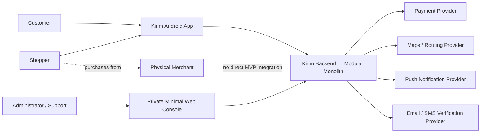

# Technical Stack and Architecture

> Status: Draft — choose tools from product constraints, not preference alone.

## 1. Architecture Overview

- **Architecture style:** Modular monolith (`DECISIONS.md`, DEC-001)
- **System context:** One Android application for Customer/Shopper role switching, one private minimal Admin/Support web application, and one trusted backend integrating with approved external providers (`DECISIONS.md`, DEC-002).
- **Primary components:** Android client, private Admin/Support web client, backend API process, durable background worker/scheduler, relational database, private evidence/file storage, and nine domain-oriented backend modules (`DECISIONS.md`, DEC-003).
- **External dependencies:** Bounded managed-services strategy: use managed commodity infrastructure while Kirim retains authoritative domain logic; required functional integrations are payment, maps/routing, Android push, email/SMS delivery, and controlled Android distribution (`DECISIONS.md`, DEC-004).
- **Deployment model:** Managed application platform with separately configured API, durable worker, and private Admin/Support web services; managed data infrastructure; and isolated local, CI/test, staging, and production environments (`DECISIONS.md`, DEC-005).



**Trust and authority boundaries**

- Mobile and web clients are untrusted callers; the backend enforces authorization and workflow rules.
- The backend is authoritative for Kirim business state.
- The payment provider is authoritative for provider-side financial events; Kirim verifies and reconciles them.
- External notifications prompt users but never change transaction state by themselves.
- Physical merchants are outside the Kirim software boundary for the MVP.

**Primary component model**

```text
Clients
├── Kirim Android application
└── Private minimal Admin/Support web console

Application runtime (one modular-monolith codebase)
├── Backend API process
└── Durable background worker/scheduler

Data
├── Relational database
├── Private evidence/file storage
└── Durable job state (implementation not yet selected)

Backend modules
├── Identity and Accounts
├── Journeys and Matching
├── Requests and Negotiation
├── Fulfilment Workflow
├── Payments and Ledger
├── Communication and Notifications
├── Trust and Safety
├── Support and Audit
└── Evidence and Files
```

- The API handles interactive requests; the worker handles delayed, retryable, reconciliation, notification, settlement, and retention work.
- API and worker share domain rules and the authoritative relational database but run as separate processes.
- Module interfaces own business invariants and data access; sharing a database does not permit bypassing module ownership.
- The Kirim ledger records immutable Kirim-side financial events and reconciles provider events; it does not replace the payment provider's authoritative records.

**External-dependency strategy**

Managed commodity services may be selected for application hosting, relational database operations/backups, private object storage, durable jobs/queues, secrets, and observability. Exact adoption and vendors remain undecided.

Required external functional capabilities are:

1. Payment processing and the approved marketplace settlement flow.
2. Maps, geocoding, and routing.
3. Android push-notification delivery.
4. Email and SMS delivery for verification, recovery, and security communication.
5. Controlled Android application distribution.

Kirim retains server-side ownership of authorization, matching, workflow state, financial reconciliation/eligibility, disputes, evidence access, and audit meaning. Public clients do not directly mutate authoritative domain data through provider databases or provider-specific business rules.

No provider capability is accepted based on assumption. Before selection, verify official documentation, sandbox behavior, contractual terms, security/privacy controls, data handling, failure behavior, export/recovery, pricing/quotas, and applicable legal requirements.

**Deployment model**

```text
Managed application platform
├── Backend API service
├── Durable worker service
├── Private Admin/Support web application
└── One-off migration/release tasks

Managed data services
├── Relational database
├── Private evidence/file storage
└── Durable job state
```

- API and worker are separately configured processes from the same modular-monolith codebase/artifact.
- Local, CI/test, staging, and production use isolated configuration; staging and production use separate data stores, secrets, and provider credentials.
- Public clients cannot connect directly to the production database or evidence storage.
- Database migrations run as an explicit controlled release task.
- The selected platform must prove long-running worker support, safe restarts, health checks, private connectivity, secret handling, logs/monitoring integration, and required backup/recovery behavior.
- The managed application platform may remain the production model after MVP; migration occurs only when measured requirements justify it.

## 2. Technology Decisions

| Layer | Choice | Version | Why | Alternatives considered |
|---|---|---|---|---|
| Mobile client | Flutter with Dart; Android-first release | Pin before implementation from verified official compatibility data | Existing Dart experience; one mobile codebase; Android MVP with a path to later iOS evaluation; native platform adaptations remain available | Native Kotlin/Jetpack Compose; React Native/TypeScript; separate Kotlin and Swift clients; Kotlin Multiplatform; PWA (`DECISIONS.md`, DEC-006) |
| Admin web client | React SPA with TypeScript | Pin before implementation from verified official compatibility data | Existing React experience; suitable for minimal tables/forms/evidence review; separate deployable client without another full-stack server | Backend-rendered pages; full-stack React framework; Flutter Web; low-code Admin platform (`DECISIONS.md`, DEC-007) |
| Server/API | CPython 3.14 with FastAPI and an ASGI server (expected Uvicorn) | Latest compatible Python 3.14 patch and exact dependency set selected/tested at scaffolding, then locked; no prerelease/yanked or automatic production upgrades | Existing experience; runtime validation; OpenAPI; rapid MVP iteration; API/Worker share services; modern supported runtime without immediate Python 3.15 adoption | NestJS/TypeScript; Django/DRF; Kotlin/Spring Boot or Ktor; Go; Python 3.15 immediately (`DECISIONS.md`, DEC-008 and DEC-020) |
| API style | Pragmatic REST-style HTTP JSON with OpenAPI; resources for reads/creation and explicit action subresources for workflow transitions | Detailed resource contracts and OpenAPI tooling TBD | Strong FastAPI/client fit; inspectable contracts; prevents arbitrary state mutation; supports verified webhooks | GraphQL; pure RPC; gRPC; REST/GraphQL hybrid (`DECISIONS.md`, DEC-018) |
| API conventions | `/api/v1`; RFC 9457 problems; opaque cursor pagination; allowlisted filters/sorts; required idempotency keys for consequential actions; strong ETag/`If-Match` where eligible plus transactional state checks | Limits, codes, cursor/fingerprint encoding, retention, and compatibility windows TBD in API contracts | Predictable mobile/Admin behavior; safe retries and concurrency; stable changing collections; explicit compatibility | Header/no versioning; custom-only errors; offset default; arbitrary query language; no keys; last-write-wins (`DECISIONS.md`, DEC-019) |
| Database | PostgreSQL with PostGIS | Pin before implementation after managed-service and library compatibility verification | Strong relational transactions/constraints plus indexed geofence, route, point, corridor, proximity, and containment queries | PostgreSQL without PostGIS; MySQL spatial; SQLite; distributed SQL (`DECISIONS.md`, DEC-009) |
| PostgreSQL driver/access | Psycopg 3 with synchronous access initially for API and Worker | Exact compatible driver version locked at scaffolding | Simpler transactional behavior, testing, and debugging at MVP scale; one execution model; Psycopg retains an async path | Psycopg 3 async; `asyncpg`; Psycopg 2; mixed execution models (`DECISIONS.md`, DEC-021) |
| ORM/query approach | SQLAlchemy 2 hybrid: typed ORM for ordinary persistence; Core or parameterized SQL for complex PostGIS/reporting/locking/tuned queries | Exact compatible SQLAlchemy and optional GeoAlchemy2 versions locked at scaffolding | One transaction/toolkit model without forcing complex database-specific queries through ORM abstractions; transport schemas remain separate | ORM-only; Core/raw SQL only; SQLModel; direct Psycopg; generic repository framework (`DECISIONS.md`, DEC-022) |
| Database migrations | Alembic; reviewed committed revisions, one controlled deployment job, forward-safe expand/contract policy | Exact compatible Alembic/GeoAlchemy2 versions locked at scaffolding | SQLAlchemy integration with explicit SQL escape hatch; reproducible history; controlled PostgreSQL/PostGIS and recovery handling | Separate SQL runner; Flyway/Liquibase; provider-console changes; startup synchronization (`DECISIONS.md`, DEC-023) |
| Connection pooling | Small explicitly bounded SQLAlchemy `QueuePool` per long-running API/Worker process; no self-managed PgBouncer initially | Exact sizes/timeouts deferred until provider and deployment concurrency are known | Reuses connections without another MVP service; global budget protects managed PostgreSQL limits | Provider/external pooler immediately; stacked pools; no reuse; SQLAlchemy defaults (`DECISIONS.md`, DEC-024) |
| Evidence files | Backend-streamed uploads/downloads to private object storage; pending/quarantine processing, immutable originals, sanitized derivatives where needed | Provider, formats, limits, scanning, encryption/key, and retention-job implementation TBD | Preserves no-direct-public-storage boundary; centralizes changing authorization and audited Support access; sufficient for bounded MVP evidence | Signed direct transfer deferred; PostgreSQL blobs; public URLs (`DECISIONS.md`, DEC-026) |
| Durable jobs / cache | PostgreSQL-backed durable jobs with transactional outbox; no shared cache initially; Procrastinate is the leading implementation candidate pending a mandatory compatibility/failure-recovery spike | Exact implementation TBD; job classes use at-least-once delivery, idempotency, bounded exponential backoff with jitter, short claims/leases, reconciliation, and visible permanent failure | Atomic state/job creation, fewer services, inspectable recovery, sufficient for pilot; explicit policies protect against duplicate/uncertain consequential effects | Kirim-owned queue table; PgQueuer; Redis queue/cache; managed cloud queue; dedicated broker; uniform/infinite/no retries (`DECISIONS.md`, DEC-010 and DEC-025) |
| Authentication ownership | Managed authentication proof with Kirim-owned internal accounts and server-side authorization | Provider and protocol versions TBD after verified evaluation | Reduces credential/MFA/recovery burden while retaining Kirim roles, suspension, transaction access, case scope, and audit authority | Fully Kirim-owned authentication; fully provider-controlled identity/authorization; direct client-to-provider data access (`DECISIONS.md`, DEC-011) |
| Customer/Shopper login | Email and password; mandatory one-time email verification and SMS phone verification before transactional access | Exact provider, policies, and verification mechanisms TBD | One MVP login path; lower recurring SMS use; avoids initial account-linking complexity; managed provider owns credentials | Social login deferred as first post-MVP candidate; phone OTP; email magic link/OTP; passkeys; multiple methods (`DECISIONS.md`, DEC-012) |
| Customer verification/recovery | Provider-managed email verification and email-only password-reset links; controlled phone/email change flows with recent reauthentication, new-channel verification, notifications, and session invalidation | Provider, link lifetimes, rate limits, normalization, and recovery exceptions TBD | Familiar low-friction flow; stable internal identity; additional current-email confirmation for phone changes | In-app email codes; mandatory two-channel recovery; phone-only recovery; support-only recovery; old-and-new approval for every change (`DECISIONS.md`, DEC-015) |
| Mobile session | OAuth 2.0 Authorization Code with PKCE and OpenID Connect; short-lived provider access token for Kirim API; provider-managed rotating/replay-protected refresh session | Exact provider, lifetimes, claims, redirect, and secure-storage integration TBD | Standards-based native public-client flow without making Kirim an MVP token issuer; backend still checks internal account and authorization | Kirim token exchange; opaque Kirim session; long-lived token; ID Token misuse (`DECISIONS.md`, DEC-013) |
| Admin authentication/session | Managed-provider email/password plus mandatory TOTP MFA; Kirim server-side opaque session in Secure HttpOnly cookie; 30-minute idle and 8-hour absolute expiry | Provider, session/CSRF implementation, cookie topology, and recent-auth policy TBD | Stronger privileged assurance, no script-readable session secret, immediate Kirim revocation, bounded lifetime | Provider token in SPA memory; browser storage tokens; Admin BFF; SMS/email MFA; WebAuthn required at MVP launch (`DECISIONS.md`, DEC-014) |
| Authorization | Deny-by-default hybrid module-owned policies combining capability, resource relationship, principal attributes, case assignment, and workflow state | Policy API/naming and disclosure-safe response conventions TBD | Accurately models same-account roles, ownership, state, support scope, jobs, and provider events across API/worker | RBAC only; scattered route checks; external policy engine; client-side authorization (`DECISIONS.md`, DEC-016) |
| Session revocation / compromise | Provider revocation plus Kirim account status, security hold, and authentication-valid-after/security-version checks | Exact provider claims/APIs, schema, triggers, and device controls TBD | Immediate Kirim business-access control without relying only on token expiry; preserves active obligations for Support | Provider-only expiry/revocation; per-token denylist; introspection on every request (`DECISIONS.md`, DEC-017) |
| Testing | TBD | TBD | TBD | TBD |
| Build/package manager | Deferred until backend scaffolding; `uv` is the leading candidate | Pin the selected tool in CI; commit one authoritative lockfile | Verify Windows development, Linux deployment, Python 3.14, and API/Worker dependency groups before standardizing | Poetry; PDM; pip-tools |
| Hosting/CI | TBD | TBD | TBD | TBD |
| Observability | TBD | TBD | TBD | TBD |

Pin runtime and package-manager versions after selection.

## 3. Repository Structure

```text
/
├── docs/               # Product and architecture documentation
├── src/                # Application source (planned)
├── tests/              # Automated tests (planned)
├── AGENTS.md            # Instructions for contributors/agents
└── README.md            # Setup and project overview (recommended)
```

Revise this tree when the architecture is approved.

## 4. Engineering Standards

- **Language/style guide:** TBD
- **Formatting/linting:** TBD
- **Type checking:** TBD
- **Unit/integration/end-to-end strategy:** TBD
- **Minimum coverage or critical-path policy:** TBD
- **Branch/commit convention:** TBD
- **Dependency update policy:** TBD

## 5. Configuration and Secrets

- Keep environment-specific configuration outside source code.
- Commit a safe `.env.example`, never real secrets.
- Validate required configuration at startup.
- Document local, test, staging, and production differences.
- Use a managed secret store in deployed environments.

## 6. Security Baseline

- Apply least privilege and deny by default.
- Use parameterized database access and output encoding.
- Validate and normalize untrusted input.
- Encrypt sensitive data in transit and, where needed, at rest.
- Rate-limit abuse-sensitive endpoints.
- Keep dependencies scanned and patched.
- Avoid sensitive values in logs and telemetry.

## 7. Environments and Delivery

| Environment | Purpose | Data policy | Deployment trigger |
|---|---|---|---|
| Local | Development | Synthetic only | Manual |
| Test/CI | Automated validation | Synthetic only | Pull request |
| Staging | Pre-release verification | TBD | TBD |
| Production | Live service | Approved policy | TBD |

## 8. Architecture Decision Records

Record consequential decisions under `docs/adr/` using:

- Context
- Decision
- Consequences
- Alternatives considered
- Date and status

## 9. Open Decisions

- [ ] Confirm MVP and expected scale.
- [ ] Choose client/server architecture.
- [ ] Choose datastore and hosting.
- [ ] Define authentication and authorization.
- [ ] Define CI quality gates and deployment strategy.
