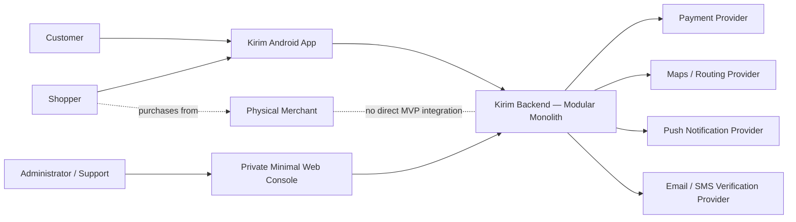

# Technical Stack and Architecture

> Status: Product Owner review draft — recommended stack is complete; Section 9 lists evidence-gated provider/library approvals that cannot be finalized by preference alone.

## 1. Architecture Overview

- **Architecture style:** Modular monolith (`DECISIONS.md`, DEC-001)
- **System context:** One Android application for Customer/Shopper role switching, one private minimal Admin/Support web application, and one trusted backend integrating with approved external providers (`DECISIONS.md`, DEC-002).
- **Primary components:** Android client, private Admin/Support web client, backend API process, durable background worker/scheduler, relational database, private evidence/file storage, and nine domain-oriented backend modules (`DECISIONS.md`, DEC-003).
- **External dependencies:** Bounded managed-services strategy: use managed commodity infrastructure while Kirim retains authoritative domain logic; required functional integrations are payment, maps/routing, Android push, email/SMS delivery, and controlled Android distribution (`DECISIONS.md`, DEC-004).
- **Deployment model:** Managed application platform with separately configured API, durable worker, and private Admin/Support web services; managed data infrastructure; and isolated local, CI/test, staging, and production environments (`DECISIONS.md`, DEC-005).



**Trust and authority boundaries**

- Mobile and web clients are untrusted callers; the backend enforces authorization and workflow rules.
- The backend is authoritative for Kirim business state.
- The payment provider is authoritative for provider-side financial events; Kirim verifies and reconciles them.
- External notifications prompt users but never change transaction state by themselves.
- Physical merchants are outside the Kirim software boundary for the MVP.

**Primary component model**

```text
Clients
├── Kirim Android application
└── Private minimal Admin/Support web console

Application runtime (one modular-monolith codebase)
├── Backend API process
└── Durable background worker/scheduler

Data
├── Relational database
├── Private evidence/file storage
└── Durable job state (PostgreSQL; exact library remains a gated spike)

Backend modules
├── Identity and Accounts
├── Journeys and Matching
├── Requests and Negotiation
├── Fulfilment Workflow
├── Payments and Ledger
├── Communication and Notifications
├── Trust and Safety
├── Support and Audit
└── Evidence and Files
```

- The API handles interactive requests; the worker handles delayed, retryable, reconciliation, notification, settlement, and retention work.
- API and worker share domain rules and the authoritative relational database but run as separate processes.
- Module interfaces own business invariants and data access; sharing a database does not permit bypassing module ownership.
- The Kirim ledger records immutable Kirim-side financial events and reconciles provider events; it does not replace the payment provider's authoritative records.

**External-dependency strategy**

Google Cloud in Singapore is selected for the managed application runtime, PostgreSQL/PostGIS, private object storage, secrets, artifact registry, and core observability, with Firebase Hosting/FCM integrations. Identity, SMS/email, payment, maps/routing, and the exact PostgreSQL job library retain explicit evidence gates described below.

Required external functional capabilities are:

1. Payment processing and the approved marketplace settlement flow.
2. Maps, geocoding, and routing.
3. Android push-notification delivery.
4. Email and SMS delivery for verification, recovery, and security communication.
5. Controlled Android application distribution.

Kirim retains server-side ownership of authorization, matching, workflow state, financial reconciliation/eligibility, disputes, evidence access, and audit meaning. Public clients do not directly mutate authoritative domain data through provider databases or provider-specific business rules.

No provider capability is accepted based on assumption. Before selection, verify official documentation, sandbox behavior, contractual terms, security/privacy controls, data handling, failure behavior, export/recovery, pricing/quotas, and applicable legal requirements.

**Deployment model**

```text
Managed application platform
├── Backend API service
├── Durable worker service
├── Private Admin/Support web application
└── One-off migration/release tasks

Managed data services
├── Relational database
├── Private evidence/file storage
└── Durable job state
```

- API and worker are separately configured processes from the same modular-monolith codebase/artifact.
- Local, CI/test, staging, and production use isolated configuration; staging and production use separate data stores, secrets, and provider credentials.
- Public clients cannot connect directly to the production database or evidence storage.
- Database migrations run as an explicit controlled release task.
- The selected platform must prove long-running worker support, safe restarts, health checks, private connectivity, secret handling, logs/monitoring integration, and required backup/recovery behavior.
- The managed application platform may remain the production model after MVP; migration occurs only when measured requirements justify it.

## 2. Technology Decisions

| Layer | Choice | Version | Why | Alternatives considered |
|---|---|---|---|---|
| Mobile client | Flutter 3.47 stable line with bundled Dart; Android-first; min Android 11/API 30, compile/target API 36 (or higher Play requirement); pragmatic feature-first structure; Riverpod with manual providers initially | Exact Flutter/Dart/Riverpod/Gradle/AGP/JDK patches pinned after vertical-slice/plugin/device spike | Current stable reproducible line; supportable modern Android security/plugin baseline; one mobile codebase; immutable unidirectional testable state without rigid Clean Architecture | Flutter beta/dev; independent Dart; API 24 product floor; Android 13+ minimum; native Kotlin/Compose; React Native; full Clean Architecture; Bloc/Provider (`DECISIONS.md`, DEC-006, DEC-029, and DEC-059) |
| Flutter navigation | `go_router` with manual route declarations and verified HTTPS Android App Links; Riverpod-backed bootstrap/auth redirects | Pin compatible `go_router` at Flutter scaffolding; set reviewed domain/app IDs, signing fingerprints, and path allowlist before distribution | Flutter-recommended Router approach; domain-bound deep links; safe push/auth lifecycle handling without initial route codegen | Custom Router; `auto_route`; named routes; custom schemes as product default (`DECISIONS.md`, DEC-030) |
| Flutter API client | Dio transport with a pinned OpenAPI Generator `dart-dio` package behind feature repositories, subject to an OpenAPI 3.1/contract compatibility spike; bounded handwritten Dio exceptions only | Generator, Dio, serialization, and package versions pinned after spike | Typed contract-aligned client; cancellation/progress/interceptors for evidence; generated DTOs remain isolated; CI detects drift | Handwritten `http`; handwritten Dio default; Retrofit annotations; generated DTOs in UI (`DECISIONS.md`, DEC-031) |
| Mobile credential storage | Verified auth-provider SDK owns persistent refresh sessions; access tokens transient where practical; narrowly scoped Keystore-backed fallback only for Kirim-owned secrets; credentials excluded from backup | Pin provider SDK and any fallback plugin only after Android storage, rotation, logout, compromise, and backup tests | Avoids duplicating provider refresh semantics; minimizes persistent exposure; fails closed to reauthentication; backend security state remains authoritative | Store all tokens in plugin; memory-only session; ordinary local storage; embedded client secret (`DECISIONS.md`, DEC-032) |
| Mobile local persistence/offline | Online-first; Riverpod in-memory server state, minimal non-sensitive preferences, controlled temporary evidence files, no persistent domain cache or offline consequential-action queue initially | Select preference/temporary-file implementation and documented cleanup timings during the mobile vertical slice | Protects server-authoritative workflow/payment semantics and minimizes sensitive local data, migration, invalidation, and deletion burden | Persistent read cache; full offline-first sync; local replica; structured data in preferences (`DECISIONS.md`, DEC-033) |
| Maps/routing | Provider-separated Flutter display adapter and backend routing adapter normalized to PostGIS; vendor deferred; private route retention is active journey + 24h unmatched or transaction closure + 30d/approved hold; immutable Kirim geofence versions persist | Vendor/versions require explicit rights for server matching, corridor derivation and temporary retention plus contract, KL quality, privacy, cost and SDK proof under Section 9 | Preserves server-authoritative matching and historical geofence audit without indefinite private routes or assuming provider storage rights | Google immediately; Mapbox immediately; unspecified public OSM services; permanent user routes; deleted geofence history; client-authoritative routes (`DECISIONS.md`, DEC-034, DEC-056, DEC-061) |
| Mobile location | Foreground/while-in-use permission for matching/evidence; optional user-started active-transaction Android location foreground service with ongoing notification; no `ACCESS_BACKGROUND_LOCATION` initially | `geolocator` leading candidate; sampling, accuracy/freshness, service, and notification parameters set from the approved field/device spike | Least privilege with visible active-delivery sharing; avoids continuous journey tracking and full background permission/policy burden | Full background permission; visible-screen-only; third-party tracker; continuous journey tracking (`DECISIONS.md`, DEC-035) |
| Mobile evidence capture | Official `image_picker` behind a Kirim adapter; system camera primary, approved Android Photo Picker fallback, explicit preview/retake, original-byte preservation, lost-data recovery | Pin plugin and approve formats, limits, and picker eligibility per evidence purpose after physical-device and scanner tests | Minimizes camera lifecycle/device complexity while preserving submitted evidence and using existing Dio/backend quarantine flow | Custom `camera`; ML Kit scanner; OCR/barcode automation; automatic destructive transforms (`DECISIONS.md`, DEC-036) |
| Android push | Direct Firebase Cloud Messaging via `firebase_messaging`; backend HTTP v1 sending; authenticated installation tokens; minimal allowlisted payloads; server-state catch-up | Pin Firebase/plugin/API versions and approve token schema/staleness, channels, TTL, priority, and event routing during notification implementation review | Official Android/Flutter path; timely awareness without another campaign processor; push remains non-authoritative | OneSignal; polling only; SMS/email only; authoritative push data; private topics (`DECISIONS.md`, DEC-037) |
| Flutter localization | Official `gen_l10n` with ARB and `intl`; English (`en`) and Bahasa Malaysia (`ms`), device selection with English fallback and in-app override; stable localized API-code mapping | Flutter localization/`intl` and timezone implementation pinned/tested at scaffolding | Meets explicit bilingual requirement with typed build-time resources, human review, and clear MYR/Malaysia-time presentation | Third-party localization runtime; server-driven ordinary UI; hardcoded strings; raw backend prose (`DECISIONS.md`, DEC-038) |
| Mobile design/accessibility | Material 3 plus a small semantic theme/token layer; applicable WCAG 2.2 AA and Android/Flutter accessibility gates | Approve brand tokens, typography, dark-theme scope, reduced-motion behavior, and the named test-device matrix before UI implementation completion | 48 dp targets, contrast, 200% text scaling, TalkBack semantics, bilingual reflow, and accessible financial/timed/map/evidence workflows | Defaults without gates; universal AAA; custom design system from scratch; automated scanner only (`DECISIONS.md`, DEC-039) |
| Flutter testing | Official Dart/`flutter_test`/`integration_test` foundation plus selective Patrol native-system tests after compatibility spike; deterministic fakes and selective goldens | Pin packages/CLI and approve emulator/physical-device matrix and cadence during the Flutter scaffolding quality spike | Fast layered feedback plus permissions/camera/picker/notification/deep-link/foreground-service coverage in Dart | Official-only/manual native; Maestro; Appium; Patrol for every flow; arbitrary coverage-only gate (`DECISIONS.md`, DEC-040) |
| Android signing/distribution | Stage A: separate staging identity/key via Firebase App Distribution; Stage B: production identity via Play internal/closed testing, AAB, and Play App Signing; protected CI upload key | Approve app IDs, accounts/projects, key parameters, version convention, and protected CI/release workflow before Stage A distribution | Fast synthetic iteration plus realistic controlled-pilot install/update/signing; strict environment isolation and backend-authoritative invitation | Play for both; Firebase for both; manual APK; shared staging/production identity; CI-held production signing key (`DECISIONS.md`, DEC-041) |
| Admin web client | React 19.3 SPA with TypeScript 7.0, Vite static builds, React Router Data Mode/browser history, React Hook Form + Zod, and Material UI Core with a restrained theme; exact compatible patches locked at scaffolding; strict separate type-check; feature-first organization; TanStack Query owns server state/mutations; runtime-validated safe URL/config/form state; no initial Redux/Zustand, persistent query cache/drafts, service worker, React Compiler, MUI X, or second styling system | Exact patches, Node/package manager, TanStack Query defaults, test stack, generated API runtime-validation strategy, theme details, public config delivery, hosting headers/fallback, and source-map handling pinned after compatibility/deployment spikes | Current stable reproducible baseline; mature static SPA/routing/form/component tooling; semantic accessible authoritative privileged workflows without bespoke design system/global store | Older/floating/prerelease lines; CRA; custom webpack; Rsbuild; Parcel; hash/custom routing; TanStack Router; Router Framework Mode; native repeated forms; Formik/Yup; TanStack Form; React Aria/custom design; Radix/shadcn ownership; initial MUI X; backend/full-stack React; Redux/RTK Query; Zustand (`DECISIONS.md`, DEC-007, DEC-042 through DEC-047) |
| Server/API | CPython 3.14 with FastAPI and an ASGI server (expected Uvicorn) | Latest compatible Python 3.14 patch and exact dependency set selected/tested at scaffolding, then locked; no prerelease/yanked or automatic production upgrades | Existing experience; runtime validation; OpenAPI; rapid MVP iteration; API/Worker share services; modern supported runtime without immediate Python 3.15 adoption | NestJS/TypeScript; Django/DRF; Kotlin/Spring Boot or Ktor; Go; Python 3.15 immediately (`DECISIONS.md`, DEC-008 and DEC-020) |
| API style | Pragmatic REST-style HTTP JSON with OpenAPI; resources for reads/creation and explicit action subresources for workflow transitions | Detailed resources and schemas are designed in `docs/API_CONTRACTS.md`; exact OpenAPI generation/validation tools are pinned at scaffolding | Strong FastAPI/client fit; inspectable contracts; prevents arbitrary state mutation; supports verified webhooks | GraphQL; pure RPC; gRPC; REST/GraphQL hybrid (`DECISIONS.md`, DEC-018) |
| API conventions | `/api/v1`; RFC 9457 problems; opaque cursor pagination; allowlisted filters/sorts; required idempotency keys for consequential actions; strong ETag/`If-Match` where eligible plus transactional state checks | Operation-specific limits/codes and cursor/fingerprint/retention/compatibility parameters are approved with each API contract before implementation | Predictable mobile/Admin behavior; safe retries and concurrency; stable changing collections; explicit compatibility | Header/no versioning; custom-only errors; offset default; arbitrary query language; no keys; last-write-wins (`DECISIONS.md`, DEC-019) |
| Database | PostgreSQL with PostGIS | Pin before implementation after managed-service and library compatibility verification | Strong relational transactions/constraints plus indexed geofence, route, point, corridor, proximity, and containment queries | PostgreSQL without PostGIS; MySQL spatial; SQLite; distributed SQL (`DECISIONS.md`, DEC-009) |
| PostgreSQL driver/access | Psycopg 3 with synchronous access initially for API and Worker | Exact compatible driver version locked at scaffolding | Simpler transactional behavior, testing, and debugging at MVP scale; one execution model; Psycopg retains an async path | Psycopg 3 async; `asyncpg`; Psycopg 2; mixed execution models (`DECISIONS.md`, DEC-021) |
| ORM/query approach | SQLAlchemy 2 hybrid: typed ORM for ordinary persistence; Core or parameterized SQL for complex PostGIS/reporting/locking/tuned queries | Exact compatible SQLAlchemy and optional GeoAlchemy2 versions locked at scaffolding | One transaction/toolkit model without forcing complex database-specific queries through ORM abstractions; transport schemas remain separate | ORM-only; Core/raw SQL only; SQLModel; direct Psycopg; generic repository framework (`DECISIONS.md`, DEC-022) |
| Database migrations | Alembic; reviewed committed revisions, one controlled deployment job, forward-safe expand/contract policy | Exact compatible Alembic/GeoAlchemy2 versions locked at scaffolding | SQLAlchemy integration with explicit SQL escape hatch; reproducible history; controlled PostgreSQL/PostGIS and recovery handling | Separate SQL runner; Flyway/Liquibase; provider-console changes; startup synchronization (`DECISIONS.md`, DEC-023) |
| Connection pooling | Small explicitly bounded SQLAlchemy `QueuePool` per long-running API/Worker process; no self-managed PgBouncer initially | Exact sizes/timeouts deferred until provider and deployment concurrency are known | Reuses connections without another MVP service; global budget protects managed PostgreSQL limits | Provider/external pooler immediately; stacked pools; no reuse; SQLAlchemy defaults (`DECISIONS.md`, DEC-024) |
| Evidence files | Backend-streamed uploads/downloads to private object storage; pending/quarantine processing, immutable originals, sanitized derivatives where needed | GCS/ClamAV architecture selected; approve formats, limits, encryption/IAM, retention, scanner signatures, and cleanup jobs before evidence implementation | Preserves no-direct-public-storage boundary; centralizes changing authorization and audited Support access; sufficient for bounded MVP evidence | Signed direct transfer deferred; PostgreSQL blobs; public URLs (`DECISIONS.md`, DEC-026) |
| In-app messaging | Durable REST creation/retrieval, PostgreSQL ordering, transactional push hints, and foreground cursor refresh; no initial persistent socket | FCM selected; approve polling/page limits, acknowledgement/read semantics, ephemeral client behavior, and retention in messaging contracts before implementation | Offline-safe authoritative history and simple MVP operation; push/socket delivery never replaces catch-up | WebSockets; SSE; managed chat; push payload as message (`DECISIONS.md`, DEC-027) |
| Spatial model | EPSG:4326 canonical coordinates; geography Points/LineStrings for metre distance; geometry MultiPolygons for versioned geofences; GiST indexes | Pin PostGIS/GeoAlchemy2 with Cloud SQL compatibility and approve GPS accuracy/freshness thresholds from field evidence | Aligns mobile/map coordinates with indexed spheroid-aware metre thresholds and boundary-inclusive auditable geofences | Projected CRS canonical; duplicate CRS storage; manual degree calculations; persisted route buffers (`DECISIONS.md`, DEC-028) |
| Durable jobs / cache | PostgreSQL-backed durable jobs with transactional outbox; no shared cache initially; Procrastinate remains the conditional candidate pending a mandatory Python 3.14/Psycopg 3/SQLAlchemy transaction and worker-connector recovery spike | Library exact version unresolved; job classes use at-least-once delivery, idempotency, bounded jittered retries, short leases, reconciliation, and visible permanent failure | Atomic state/job creation, fewer services, inspectable recovery, sufficient for pilot; does not hide the sync/worker connector compatibility gate | Kirim-owned queue table; PgQueuer; Redis/cache; cloud queue; broker; premature Procrastinate approval (`DECISIONS.md`, DEC-010 and DEC-025) |
| Authentication ownership | Auth0 is the conditional leading managed identity provider; Kirim owns accounts/authorization; native PKCE/OIDC, rotating refresh sessions, email verification/reset, and Admin TOTP must pass the mandatory spike | Auth0 tenant/region/plan/SDK/protocol settings unapproved until capability, cost, DPA, recovery, and integration proof | Strong fit with approved standards and managed credential/MFA flows while preserving Kirim authority; explicit gate avoids assuming phone/profile/provider behavior | Firebase Auth; Cognito; fully Kirim-owned auth; fully provider-controlled authorization; direct provider data access (`DECISIONS.md`, DEC-011 through DEC-017 and DEC-055) |
| Customer/Shopper login | Email and password; mandatory one-time email verification and SMS phone verification before transactional access | Auth0/Twilio conditional candidates; exact plans, policies, and mechanisms require the Section 9 provider gates | One MVP login path; lower recurring SMS use; avoids initial account-linking complexity; managed provider owns credentials | Social login deferred as first post-MVP candidate; phone OTP; email magic link/OTP; passkeys; multiple methods (`DECISIONS.md`, DEC-012) |
| Customer verification/recovery | Provider-managed email verification and email-only password-reset links; controlled phone/email change flows with recent reauthentication, new-channel verification, notifications, and session invalidation | Auth0 conditional candidate; approve link lifetimes, rate limits, normalization, and recovery exceptions in the identity spike | Familiar low-friction flow; stable internal identity; additional current-email confirmation for phone changes | In-app email codes; mandatory two-channel recovery; phone-only recovery; support-only recovery; old-and-new approval for every change (`DECISIONS.md`, DEC-015) |
| Mobile session | OAuth 2.0 Authorization Code with PKCE and OpenID Connect; short-lived provider access token for Kirim API; provider-managed rotating/replay-protected refresh session | Auth0 conditional candidate; approve lifetimes, claims, redirects, rotation/reuse behavior, and secure-storage integration in the native-auth spike | Standards-based native public-client flow without making Kirim an MVP token issuer; backend still checks internal account and authorization | Kirim token exchange; opaque Kirim session; long-lived token; ID Token misuse (`DECISIONS.md`, DEC-013) |
| Admin authentication/session | Managed-provider email/password plus mandatory TOTP MFA; Kirim opaque server session in host-only Secure HttpOnly SameSite=Strict cookie; same-origin proxied Admin API; session-bound in-memory synchronizer CSRF header plus exact Origin validation; 30-minute idle/8-hour absolute expiry | Auth0 conditional candidate; approve exact hosts/cookie/header/token, session implementation, CSP, recent-auth window, and concurrent-session policy before Admin authentication implementation; separate same-site origin is reviewed fallback only | Strong privileged assurance, no script-readable credential, layered CSRF, immediate revocation, bounded lifetime, reduced credentialed-CORS risk | Provider token in SPA memory; browser-storage tokens; SameSite-only CSRF; separate origin by default; dedicated Admin BFF; SMS/email MFA; mandatory launch WebAuthn (`DECISIONS.md`, DEC-014 and DEC-048) |
| Authorization | Deny-by-default hybrid module-owned policies combining capability, resource relationship, principal attributes, case assignment, and workflow state | Define the policy API/naming and disclosure-safe responses with the authorization matrix before protected endpoints are implemented | Accurately models same-account roles, ownership, state, support scope, jobs, and provider events across API/worker | RBAC only; scattered route checks; external policy engine; client-side authorization (`DECISIONS.md`, DEC-016) |
| Session revocation / compromise | Provider revocation plus Kirim account status, security hold, and authentication-valid-after/security-version checks | Approve provider claims/APIs, security-version schema, revocation triggers, and device/session controls in the identity compromise spike | Immediate Kirim business-access control without relying only on token expiry; preserves active obligations for Support | Provider-only expiry/revocation; per-token denylist; introspection on every request (`DECISIONS.md`, DEC-017) |
| Phone verification / transactional email | Twilio Verify conditional candidate for Malaysian SMS phone verification; Amazon SES `ap-southeast-1` conditional candidate for Kirim email; Auth0 owns approved credential emails | Accounts, templates, domains, regions, rate/fraud controls, webhook/event handling, DPA, and production approval gated by deliverability/compliance spikes | Focused verification, Malaysia guidance, Singapore email endpoint, provider event handling; no OTP storage | SMS login/MFA; generic messaging API; Postmark without regional proof; self-hosted SMTP (`DECISIONS.md`, DEC-055) |
| Payment provider | Stripe Connect Malaysia is the leading candidate only; no production approval until exact held-funds, shopper advance, 24-hour dispute-blocked settlement, liability, refund/reversal, payout, webhook, reconciliation, legal/tax/accounting model is proven | Provider/account/product configuration unapproved; sandbox and contract gate mandatory before payment implementation/Stage B | Available marketplace primitives and sandbox, while preserving a hard blocker against assumed escrow/settlement capability | Adyen/Airwallex/Xendit/local acquirer fallback; generic gateway; manual transfer; Kirim wallet/escrow (`DECISIONS.md`, DEC-057) |
| Object storage / file safety | Regional private GCS pending/clean/original/derivative/quarantine states; backend proxy; magic/decode limits; isolated maintained ClamAV scan; fail-closed manual review; immutable originals | Bucket topology, retention/soft-delete, scanner image/signature cadence, formats/limits and keys finalized before evidence implementation | Cohesive Singapore storage and documented scan architecture; least privilege and no release-before-scan | Public/signed direct default; PostgreSQL blobs; timeout-as-clean; destructive original replacement; assumed AI moderation (`DECISIONS.md`, DEC-026, DEC-053, DEC-056) |
| Testing | Backend pytest + real disposable PostgreSQL/PostGIS + contract/E2E; Admin Vitest/Testing Library/MSW/axe/Playwright; Flutter official tests + bounded Patrol; risk-based critical-path coverage | Exact compatible packages, containers, browser/device matrix, and cadence pinned at scaffolding | Layered fast feedback plus real database/browser/native-system proof; direct financial/auth/security/provider testing | SQLite-only; browser-only; snapshots/coverage percentage as quality proof (`DECISIONS.md`, DEC-040, DEC-049, DEC-051) |
| Build/package manager | Monorepo; uv for Python, pnpm for Admin, repository-pinned Flutter SDK with FVM leading; deterministic ecosystem lockfiles | Exact uv/pnpm/Node LTS/FVM versions pinned after Windows/Linux/CI compatibility spike | Fast reproducible installs and coordinated contracts/releases without cross-language shared-domain coupling | Multi-repo; Poetry/PDM/pip-tools; npm/yarn; unpinned global Flutter (`DECISIONS.md`, DEC-050) |
| Hosting/CI | GCP Singapore: Cloud Run API and restart-tolerant min-instance Worker, Cloud Run migration jobs, Cloud SQL PostGIS, GCS, Secret Manager, Artifact Registry; Firebase Hosting same-origin Admin rewrite; GitHub Actions with OIDC and immutable promotion; Terraform leading IaC | Exact SKUs/sizes/IAM/networking/provider versions/HA/cost limits pinned before Stage A/B; maps/payment/identity gates remain separate | Managed cohesive Singapore stack, same-origin Admin, FCM integration, short-lived CI credentials, explicit migrations and recovery | AWS/Azure; Render/Railway/Fly; Kubernetes; static cloud keys; workstation deploys (`DECISIONS.md`, DEC-052 and DEC-053) |
| Observability | Cloud Logging/Monitoring/Error Reporting + OpenTelemetry backend/worker; privacy-minimized Firebase Crashlytics Android after review; scrubbed Admin error envelope to backend; no session replay | Retention, sampling, dashboards, alerts, Crashlytics collection/privacy, on-call routes and SLOs finalized before Stage B | Managed platform telemetry with portable instrumentation and minimized client data/processors | Unstructured logs only; initial full Sentry; browser session replay; audit-as-logs (`DECISIONS.md`, DEC-054) |

Pin exact runtime, package-manager, framework, plugin, and provider SDK versions only after the documented compatibility spikes; CI and committed lock/config files become authoritative thereafter.

## 3. Repository Structure

```text
/
├── apps/
│   ├── mobile/                 # Flutter Customer/Shopper Android application
│   └── admin/                  # React/TypeScript/Vite private Admin SPA
├── services/
│   └── backend/                # FastAPI modular monolith, Worker, migrations, tests
├── infra/                      # Terraform modules/environments and deployment config
├── docs/                       # Requirements, contracts, schema, workflow, runbooks
├── scripts/                    # Small cross-project developer/CI commands
├── AGENTS.md
├── DECISIONS.md
└── README.md
```

- This is one Git monorepo with independently buildable/deployable applications.
- Keep backend modules inside the backend package and enforce ownership through Python package interfaces, not separate services.
- Generated OpenAPI clients live in clearly generated subtrees under their consumers and are reproducible from the committed contract; do not hand-edit them.
- Do not create a shared cross-language domain-model package or allow clients to import backend business rules.
- Each ecosystem owns its authoritative manifest/lockfile; repository scripts orchestrate but do not replace native tools.
- Infrastructure state is remote/protected and never committed. Build output, credentials, local environments, test artifacts, `.unipi/`, and tool caches remain ignored.

See `DECISIONS.md`, DEC-050.

## 4. Engineering Standards

- **Python:** Ruff format/lint; Pyright strict project settings; explicit typed boundaries; pytest with real PostgreSQL/PostGIS integration tests.
- **TypeScript/React:** Prettier; ESLint flat config with typescript-eslint, React and accessibility rules; strict `tsc --noEmit`; Vitest/Testing Library/MSW/axe/Playwright.
- **Dart/Flutter:** `dart format`, `flutter analyze`, official test layers, selective Patrol native-system tests.
- **Contracts:** OpenAPI is generated/validated in CI; generated clients must be reproducible and drift-free; use an approved breaking-change checker with consumer compilation/contract tests.
- **Coverage:** Report coverage to find gaps, but gate directly on critical authorization, financial/ledger, retry/idempotency, concurrency, provider, session/CSRF, evidence/location, migration/restore, and regression behavior rather than one arbitrary percentage.
- **Security checks:** dependency review/alerts, CodeQL where supported, secret scanning plus Gitleaks, OSV/dependency audit, and Trivy release-image scanning. Suppressions require owner, rationale, expiry, and compensating control.
- **Git:** protected `main`, short-lived branches, pull requests, required checks/review, squash merge, Conventional Commit-style messages, and no force-push to protected history.
- **Dependencies:** exact direct pins and committed lockfiles; isolated update changes; automated patches only after checks; reviewed minors; explicitly approved majors; no hidden framework upgrades in feature work.
- **Generated/build files:** do not commit build output, reports, local credentials, provider secrets, or generated files that CI can reproduce unless the approved client-generation workflow explicitly requires reviewable generated source.

See `DECISIONS.md`, DEC-049 through DEC-052.

## 5. Configuration and Secrets

- Define typed, fail-fast configuration schemas separately for API, Worker, migration jobs, Admin public runtime/build configuration, and mobile flavors.
- Keep environment-specific values outside source code. Commit safe examples/templates only; never commit real `.env` files, keystores, provider credentials, Terraform state, Playwright auth state, or service-account keys.
- Use Google Secret Manager and least-privilege service identities in deployed environments; CI uses GitHub OIDC/Workload Identity Federation rather than static cloud keys.
- Pin secret versions for controlled releases or use reviewed mounted-rotation behavior; document owner, consumers, rotation, revocation, and recovery for every production secret.
- Treat all mobile and browser configuration as public. No client artifact contains server secrets or unrestricted API keys; public provider keys use package/signing/domain/API restrictions and quotas.
- Use distinct projects, domains, buckets, databases, Auth0 tenants/applications, Firebase apps, provider credentials, signing identities, and callback/deep-link configuration for staging and production.
- Validate contradictory environment combinations and fail closed—for example production identity with staging API, public bucket, disabled CSRF, sandbox payment, or synthetic-data flags.
- Do not log configuration values merely because validation fails. Produce names and remediation, not secret contents.

See `DECISIONS.md`, DEC-041, DEC-044, DEC-048, DEC-052, DEC-053, and DEC-055.

## 6. Security Baseline

- Apply least privilege and deny by default.
- Use parameterized database access and output encoding.
- Validate and normalize untrusted input.
- Encrypt sensitive data in transit and, where needed, at rest.
- Rate-limit abuse-sensitive endpoints.
- Keep dependencies scanned and patched.
- Avoid sensitive values in logs and telemetry.

## 7. Environments and Delivery

| Environment | Purpose | Data policy | Deployment trigger |
|---|---|---|---|
| Local | Developer work and focused manual tests | Synthetic fixtures and provider fakes/sandboxes only | Manual repository commands |
| Test/CI | Automated unit, contract, real PostGIS, browser and selected emulator tests | Ephemeral synthetic data; no reusable production credentials | Pull request and protected branch checks |
| Staging / Stage A | Deployed-like integration, synthetic end-to-end workflow, provider sandboxes, internal Android distribution | Synthetic only; isolated GCP/Auth0/Firebase/provider resources | Immutable artifact promotion after CI; Firebase App Distribution for Android |
| Production / Stage B | Invite-only real-user pilot after every entry gate | Approved minimum real data with documented retention/access/deletion; no production copy to lower environments | Explicit GitHub Environment approval, migration/preflight, controlled deploy, smoke/reconciliation checks; Play closed track |

**Delivery and recovery**

- Build once and promote immutable container/static/mobile artifacts with commit, checksum, dependency locks, migration head, and release notes.
- Run reviewed Alembic migrations as a Cloud Run Job, never at API/Worker startup. Use expand/migrate/contract and resumable jobs for large backfills.
- Deploy API and Worker separately from the same release, verify health/readiness and Worker/job reconciliation, then deploy Admin/mobile-compatible changes.
- Prefer roll-forward. Application rollback may redeploy a known compatible digest; never automatically reverse applied migrations.
- Enable and monitor Cloud SQL backups/PITR and GCS recovery/retention controls. Demonstrate isolated restore and reconciliation before Stage B and on a schedule thereafter.
- Provide audited server-side pilot pause controls for intake, acceptance, payments, settlement/payout, evidence, messaging, and full-pilot suspension where safe.
- Maintain release, rollback/forward-recovery, backup/restore, provider outage, payment reconciliation, security incident, and user communication runbooks.

**Cost controls**

- Stage A targets RM150/month with an RM300/month planning ceiling; the initial Stage B pilot targets RM300/month (`DECISIONS.md`, DEC-060).
- Configure budget alerts near 50%, 75%, 90%, and 100%, explicit autoscaling/quota/retention limits, and weekly active-pilot cost review.
- Scale non-production resources down/off when safe; Stage A may use an on-demand Worker and no HA database.
- Stage B does not remove required backup/PITR, restore, security, audit, evidence, payment reconciliation, or incident controls to meet budget. Escalate with measured options instead.
- Payment fees, professional review, labor, and one-time registration/domain/Play/business costs are tracked separately.

See `DECISIONS.md`, DEC-041, DEC-052, DEC-053, DEC-057, DEC-058, and DEC-060.

## 8. Architecture Decision Records

`DECISIONS.md` is the current authoritative decision log. Each consequential decision records context, decision, alternatives, consequences, revisit triggers, date/status, and affected areas. If the log later becomes unwieldy, split records into `docs/adr/` through an approved mechanical migration while preserving identifiers and history.

## 9. Gated Selections and Implementation Spikes

The architecture and recommended stack are complete for Product Owner review. The following choices intentionally remain gated because official terms, sandbox/device behavior, or contracts—not preference—must decide them:

- [ ] **Maps/routing/geocoding vendor:** Google display remains a candidate, but the provider must permit server matching/corridor derivation and DEC-061 temporary retention; compare contractually permitted split-provider options, map-pairing terms, privacy, pricing, and KL route quality (`DECISIONS.md`, DEC-034, DEC-056, and DEC-061).
- [ ] **Production payment provider:** Stripe Connect is the leading candidate, but exact Malaysian funds flow, liability, payout, refund/dispute, 24-hour settlement, legal/tax/accounting, and sandbox recovery proof is mandatory (`DECISIONS.md`, DEC-057).
- [ ] **Identity/SMS/email production approval:** Auth0, Twilio Verify, and Amazon SES are conditional selections pending plan/region/DPA, SDK, MFA/recovery, Malaysia delivery/compliance, sender-domain, event, and cost tests (`DECISIONS.md`, DEC-055).
- [ ] **PostgreSQL job library:** Procrastinate remains the candidate, but its worker connector/execution model must be reconciled with the approved synchronous application database model and prove transactional enqueue/crash recovery (`DECISIONS.md`, DEC-010, DEC-021, and DEC-025).
- [ ] **Exact dependency/tool versions:** lock only after the approved Windows/Linux, Python 3.14, Flutter/Gradle/Android, React/TypeScript/Vite, OpenAPI generation, Patrol, and provider SDK compatibility spikes.
- [ ] **Stage B operational parameters:** connection/concurrency budgets, retention periods, RPO/RTO, operational alert thresholds, recent-auth window, session limits, quotas, and support hours require measured/configuration review. Budget targets are approved under DEC-060.

A failed gate triggers comparison or an explicit requirement/decision change; contributors must not silently treat a candidate as production-approved.
