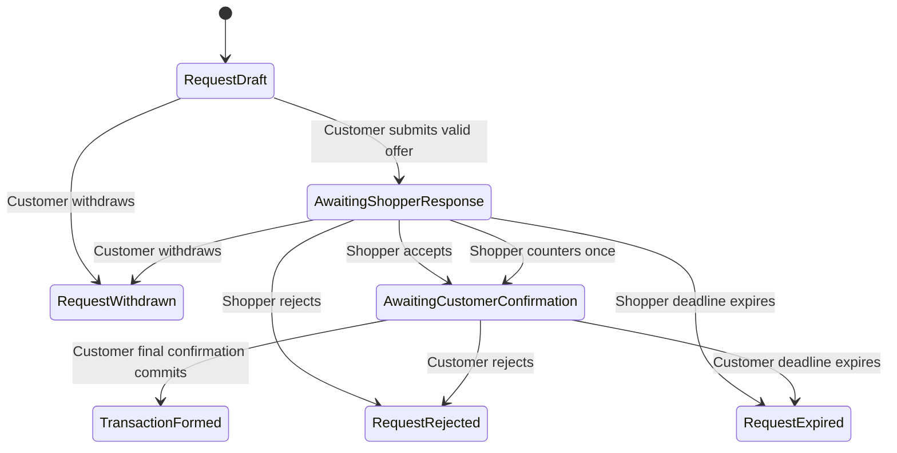
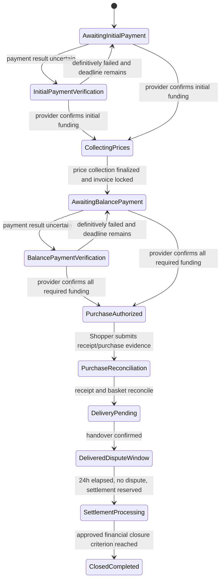
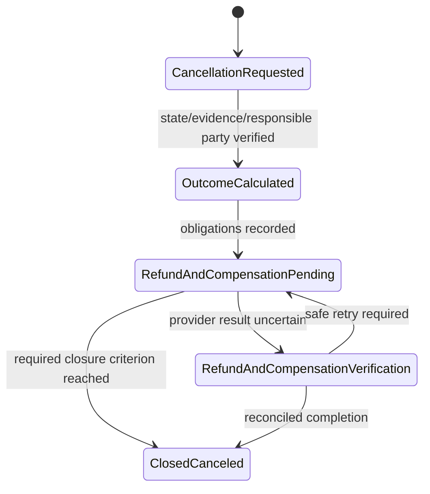

# Kirim Transaction State Machine

> Status: Draft for Product Owner and engineering review.
>
> This document translates approved requirements into a provider-neutral workflow model. It does not approve unresolved Product Owner items in Section 18, payment-provider behavior, database schema, API resource names, or implementation code.

## 1. Purpose

Define one authoritative transaction lifecycle so mobile, Admin, API, Worker, database, payment, evidence, notification, and support implementations do not invent conflicting states or transitions.

The model answers:

- When a request becomes a transaction.
- Which actions are legal in each state.
- Which timers expire offers, approvals, and payments.
- When Customer funding permits price collection or purchase.
- How cancellation, failed delivery, disputes, and Support review interrupt the normal path.
- When financial resolution and closure occur.
- Which concerns remain separate sub-state machines to avoid one unmanageable status field.

## 2. Sources and Traceability

Primary requirements:

- NEG-001 and FR-NEG-001 through FR-NEG-004
- PAY-001 through PAY-003 and FR-PAY-001 through FR-PAY-007
- SHP-001/SHP-002 and FR-SHP-001 through FR-SHP-006
- DEL-001 and FR-DEL-001 through FR-DEL-004
- CAN-001 and FR-CAN-001/FR-CAN-002
- DSP-001 and FR-DSP-001 through FR-DSP-003
- ADM-001/ADM-002 and FR-ADM-001 through FR-ADM-003
- DEC-025, DEC-027, DEC-062
- `docs/PAYMENT_DOMAIN_MODEL.md`

If this draft conflicts with `docs/REQUIREMENTS.md` or an accepted decision, the requirement/decision wins and this draft must be corrected.

## 3. State Ownership Model

A single status cannot safely represent negotiation, fulfilment, payment, disputes, settlement, holds, and provider operations. Kirim therefore uses coordinated state regions.

### 3.1 Pre-transaction request/negotiation state

Owned by the Requests and Negotiation module. It ends when final Customer confirmation atomically creates a transaction.

### 3.2 Transaction fulfilment state

Owned by the Fulfilment Workflow module. It represents the Customer/Shopper operational journey from initial funding through purchase, delivery, financial resolution, and closure.

### 3.3 Payment state

Owned by Payments and Ledger. Funding obligations/attempts, refunds, settlement, provider transfers, and payouts follow `docs/PAYMENT_DOMAIN_MODEL.md` and do not become raw transaction states.

### 3.4 Dispute/support state

Owned by Trust and Safety / Support and Audit. A dispute may block settlement while preserving the underlying delivery outcome.

### 3.5 Hold/pause flags

Security, fraud, account, provider, evidence, reconciliation, or pilot-pause controls may block named actions without rewriting historical workflow state.

### 3.6 Derived user status

Clients receive a server-derived presentation status assembled from the authoritative regions. Clients do not infer workflow from timestamps, local timers, payment SDK callbacks, or push notifications.

## 4. Universal Invariants

These rules apply in every state:

1. One transaction has exactly one Customer, one different Shopper, one shop/location, and one delivery/handover point.
2. A user cannot be both parties in the same transaction.
3. Locked terms are immutable after final confirmation except through versioned item approvals and authorized cancellation/dispute adjustments.
4. The Shopper fee cannot change after final confirmation.
5. A Shopper cannot accept or counter a request without currently eligible payout onboarding.
6. A Shopper cannot hold more than one operationally active accepted/confirmed transaction slot according to the final Section 18 decision.
7. The backend—not the client—authorizes every transition.
8. Every transition checks current state, actor, relationship, account/security status, version/precondition, and required evidence.
9. Consequential transitions are idempotent and attributable.
10. A timer expiry is a server event using authoritative time; client countdowns are display aids.
11. An uncertain external-provider result never becomes success or failure by assumption.
12. Original terms, prices, approvals, messages, receipts, delivery evidence, provider facts, and audit records are not overwritten.
13. Notifications prompt synchronization and never advance state.
14. Support actions append decisions/compensations; direct historical edits are forbidden.
15. Closing a journey does not abandon its transaction.
16. A transaction cannot reach a successful terminal state while required funding, receipt, delivery, dispute, or settlement facts are unresolved.

## 5. Pre-Transaction Request and Negotiation States

| State | Meaning | Terminal? |
|---|---|---:|
| `REQUEST_DRAFT` | Customer is preparing a one-shop request; no Shopper offer is active | No |
| `AWAITING_SHOPPER_RESPONSE` | Valid initial offer submitted; Shopper's 10-minute response window is active | No |
| `AWAITING_CUSTOMER_CONFIRMATION` | Shopper accepted or made the single counteroffer; Customer's 10-minute final-confirmation window is active | No |
| `REQUEST_WITHDRAWN` | Customer withdrew before transaction formation | Yes |
| `REQUEST_REJECTED` | Shopper or Customer rejected the current proposal | Yes |
| `REQUEST_EXPIRED` | Required negotiation response expired | Yes |
| `TRANSACTION_FORMED` | Final confirmation succeeded and transaction creation/slot reservation committed | Yes; transaction lifecycle begins |

### 5.1 Negotiation diagram



### 5.2 Final-confirmation transaction boundary

Customer final confirmation is one database transaction that verifies:

- Offer/counteroffer remains current and unexpired.
- No second counteroffer exists.
- Customer and Shopper are different eligible accounts.
- Request, items, shop, delivery point, route/geofence eligibility, and product policy remain valid.
- Shopper payout onboarding/capability remains eligible.
- Shopper has no conflicting operationally active transaction slot.
- Locked Shopper fee and terms match the version shown to the Customer.

It then:

- Creates the transaction.
- Snapshots locked terms and relevant policy/geofence versions.
- Reserves the Shopper active slot.
- Sets `initial_payment_due_at = confirmed_at + 10 minutes`.
- Creates the initial funding obligation.
- Emits transactional outbox/audit events.

No payment is initiated before this commit, and duplicate final-confirmation requests return the same transaction rather than creating another.

## 6. Canonical Transaction Fulfilment States

| State | Meaning |
|---|---|
| `AWAITING_INITIAL_PAYMENT` | Transaction formed; Customer has 10 minutes to complete initial Shopper-fee funding |
| `INITIAL_PAYMENT_VERIFICATION` | Deadline/request result is uncertain; provider lookup/reconciliation blocks further progression |
| `COLLECTING_PRICES` | Initial funding is confirmed; Shopper may record availability/prices and request approvals |
| `AWAITING_BALANCE_PAYMENT` | Itemized invoice is locked; Customer has 10 minutes to fund the outstanding balance |
| `BALANCE_PAYMENT_VERIFICATION` | Balance result is uncertain; provider lookup/reconciliation blocks purchase/cancellation assumptions |
| `PURCHASE_AUTHORIZED` | All required Customer funds confirmed; Shopper may purchase within approved basket/limits |
| `PURCHASE_RECONCILIATION` | Shopper submitted purchase/receipt evidence; Kirim is reconciling it |
| `DELIVERY_PENDING` | Receipt/basket reconciled; purchased items await handover outcome |
| `DELIVERED_DISPUTE_WINDOW` | Successful handover confirmed; 24-hour timely-dispute window is active |
| `DELIVERY_FAILED_REVIEW` | Failed-delivery procedure/evidence completed; Support resolution is required |
| `CANCELLATION_RESOLUTION` | A pre-purchase cancellation/expiry outcome is recorded; refunds/compensation are being resolved |
| `SUPPORT_REVIEW` | A post-purchase, evidence, safety, fraud, payment, or exceptional case requires authorized review |
| `DISPUTE_REVIEW` | A timely dispute is open and affected automatic settlement is blocked |
| `SETTLEMENT_PROCESSING` | Settlement eligibility was atomically reserved; provider transfer/payout lifecycle is being tracked |
| `CLOSED_COMPLETED` | Normal or authorized successful outcome reached its approved closure criterion |
| `CLOSED_CANCELED` | Pre-purchase cancellation/expiry financial obligations reached the approved closure criterion |
| `CLOSED_SUPPORT_RESOLVED` | Authorized Support outcome and required financial/evidence actions reached closure |

The exact closure criterion relative to connected-account transfer versus bank payout is **OPEN-PO-TXN-002** in Section 18.

## 7. Normal Transaction Path



## 8. Detailed Transition Table

| Event/command | Allowed from | Required guards/evidence | Result | Key side effects |
|---|---|---|---|---|
| `initial_payment_confirmed` | `AWAITING_INITIAL_PAYMENT`, `INITIAL_PAYMENT_VERIFICATION` | Verified provider state; amount/currency/obligation match; no cancellation/hold | `COLLECTING_PRICES` | Journal funding fact; notify parties; enable price recording |
| `initial_payment_uncertain` | `AWAITING_INITIAL_PAYMENT` | Request may have reached provider | `INITIAL_PAYMENT_VERIFICATION` | Block retry/progression; enqueue reconciliation |
| `initial_payment_definitively_failed` | `AWAITING_INITIAL_PAYMENT`, `INITIAL_PAYMENT_VERIFICATION` | Provider proves no financial effect | Remain/return `AWAITING_INITIAL_PAYMENT` if deadline remains | Permit new attempt without extending deadline |
| `initial_payment_deadline_expired` | `AWAITING_INITIAL_PAYMENT` | No confirmed/uncertain attempt | `CANCELLATION_RESOLUTION` | Record Customer non-payment outcome; release/resolve slot under approved rule |
| `price_recorded` | `COLLECTING_PRICES` | Shopper actor; shop/location/time/evidence valid; item allowed | Same state | Append price/evidence; may create approval request |
| `item_approval_requested` | `COLLECTING_PRICES` | Substitution/out-of-limit condition | Same state | Five-minute approval deadline and notification |
| `item_approval_recorded` | `COLLECTING_PRICES` | Customer actor; request current/unexpired | Same state | Append approval/rejection; update eligible basket |
| `item_approval_expired` | `COLLECTING_PRICES` | Five-minute deadline elapsed | Same state | Mark item skipped; preserve request/history |
| `price_collection_finalized` | `COLLECTING_PRICES` | No unresolved approvals; at least one purchasable approved item remains | `AWAITING_BALANCE_PAYMENT` | Lock invoice version; set 10-minute balance deadline |
| `price_collection_no_purchasable_items` | `COLLECTING_PRICES` | No unresolved approvals; no purchasable item remains | `CANCELLATION_RESOLUTION` or `SUPPORT_REVIEW` | Apply valid-price 50% rule or full-refund path; suspicious evidence requires review |
| `balance_payment_confirmed` | `AWAITING_BALANCE_PAYMENT`, `BALANCE_PAYMENT_VERIFICATION` | Verified provider state; invoice/amount/currency match; no hold | `PURCHASE_AUTHORIZED` | Journal funding; record maximum approved advance; notify Shopper |
| `balance_payment_uncertain` | `AWAITING_BALANCE_PAYMENT` | Request may have reached provider | `BALANCE_PAYMENT_VERIFICATION` | Block purchase/new attempt; reconcile |
| `balance_payment_definitively_failed` | `AWAITING_BALANCE_PAYMENT`, `BALANCE_PAYMENT_VERIFICATION` | Provider proves no effect; deadline remains | `AWAITING_BALANCE_PAYMENT` | Permit another attempt; deadline unchanged |
| `balance_payment_deadline_expired` | `AWAITING_BALANCE_PAYMENT` | No confirmed/uncertain attempt | `CANCELLATION_RESOLUTION` | Apply qualifying 50% compensation rule or full-refund path |
| `purchase_evidence_submitted` | `PURCHASE_AUTHORIZED` | Shopper actor; readable receipt candidate; quantities/prices supplied | `PURCHASE_RECONCILIATION` | Preserve originals; start reconciliation |
| `purchase_reconciled` | `PURCHASE_RECONCILIATION` | Receipt readable; approved basket matches within policy | `DELIVERY_PENDING` | Recognize verified eligible item cost; enable handover workflow |
| `purchase_discrepancy_found` | `PURCHASE_RECONCILIATION` | Material discrepancy or suspicious evidence | `SUPPORT_REVIEW` | Block automatic settlement; create assigned case |
| `delivery_confirmed` | `DELIVERY_PENDING` | Approved in-app handover confirmation; delivery point/context valid | `DELIVERED_DISPUTE_WINDOW` | Record delivery time; start 24-hour window; stop live sharing; evaluate slot release per Section 18 |
| `failed_delivery_recorded` | `DELIVERY_PENDING` | In-app contact attempt, 10-minute wait, arrival evidence | `DELIVERY_FAILED_REVIEW` | Stop live sharing; create Support case; block automatic settlement |
| `timely_dispute_opened` | `DELIVERED_DISPUTE_WINDOW`, `DELIVERY_FAILED_REVIEW` | Party actor; within 24h authoritative deadline; evidence/reason accepted | `DISPUTE_REVIEW` | Atomically block affected settlement; create case |
| `settlement_deadline_reached` | `DELIVERED_DISPUTE_WINDOW` | 24h elapsed; no dispute/hold; receipt/funding reconciled | `SETTLEMENT_PROCESSING` | Atomically reserve settlement; enqueue provider operation |
| `support_review_required` | Any nonterminal state where policy permits | Evidence/payment/security/provider exception | `SUPPORT_REVIEW` | Record reason; block named unsafe actions; preserve obligations |
| `support_outcome_recorded` | `SUPPORT_REVIEW`, `DISPUTE_REVIEW`, `DELIVERY_FAILED_REVIEW` | Authorized actor; reason/case/evidence/precondition; financial plan | Outcome-specific state | Append decision, compensating actions, notifications |
| `financial_closure_reached` | `SETTLEMENT_PROCESSING`, `CANCELLATION_RESOLUTION`, resolved support branch | Required provider/journal obligations meet approved closure criterion | Corresponding terminal state | Release remaining locks/slot; enable final record/rating where eligible |

## 9. Price Collection and Item Approval Sub-State

The transaction remains `COLLECTING_PRICES` while each item line has one current outcome:

- `UNRECORDED`
- `AVAILABLE_WITHIN_APPROVAL`
- `UNAVAILABLE_SKIPPED`
- `APPROVAL_PENDING`
- `APPROVED_SUBSTITUTION_OR_PRICE`
- `REJECTED_SKIPPED`
- `EXPIRED_SKIPPED`
- `PROHIBITED_OR_INVALID`

Rules:

- Original values and all revisions are immutable history.
- One current outcome is derived from append-only records.
- A five-minute approval timer is per approval request.
- A stale response cannot approve a superseded request.
- Finalization is blocked while any current approval is pending.
- If no purchasable item remains, the transaction enters `CANCELLATION_RESOLUTION`: apply the existing 50% Shopper-fee rule only when at least one valid price with required evidence was recorded; otherwise refund the Customer with no Shopper compensation, subject to approved provider costs. Suspicious evidence enters Support review.

## 10. Cancellation State Model

### 10.1 Before transaction formation

Request withdrawal/rejection/expiry is terminal and creates no Shopper charge or transaction funding obligation.

### 10.2 After transaction formation but before purchase



### 10.3 Cancellation outcomes

| Verified point | Customer-caused outcome | Shopper-caused outcome |
|---|---|---|
| Awaiting initial payment with no confirmed funds | Cancel with no Shopper compensation | Cancel with no Shopper compensation |
| Initial funded, before qualifying price collection | Refund Shopper-fee principal subject to approved provider costs | Full Customer refund according to provider capability; no Shopper compensation |
| Qualifying price collection began, before purchase | Shopper earns 50% locked fee rounded down; Customer receives remainder; provider-cost treatment gated | Full Customer refund according to capability; no Shopper compensation |
| Balance deadline expires after qualifying price collection | Same 50% allocation | Not applicable unless a separate Shopper cancellation event exists |
| After purchase | Normal cancellation unavailable; enter `SUPPORT_REVIEW` | Normal cancellation unavailable; enter `SUPPORT_REVIEW` |

Cancellation calculation and recording must be atomic with transition to `CANCELLATION_RESOLUTION`. Provider execution may complete later and cannot erase the calculated obligation.

## 11. Purchase and Receipt Rules

`PURCHASE_AUTHORIZED` means Kirim permits the Shopper to buy only the approved basket within approved quantities/prices. It is not proof that a purchase occurred.

Required controls:

- All required Customer funding confirmed and reconciled.
- Maximum personal advance shown to the Shopper.
- Approved basket/invoice version fixed.
- No unresolved approval, cancellation, dispute, security, provider, or pilot hold.
- Shopper capability rechecked.
- Purchase outside approved limits cannot become automatically reimbursable.
- Receipt submission preserves original bytes and structured claimed values.
- Reconciliation compares receipt, approved basket, funding, and claimed quantities/prices.
- Material discrepancy enters `SUPPORT_REVIEW`; it never silently adjusts the invoice or reimbursement.

Purchase-authorization and receipt-submission deadlines remain **OPEN-PO-TXN-004**.

## 12. Delivery and Failed-Delivery Rules

### Successful delivery

- Exactly one delivery/handover point is current and locked.
- Approved in-app handover confirmation is required.
- Server records authoritative `delivery_confirmed_at`.
- Live location stops immediately.
- Timely dispute deadline is exactly 24 hours from authoritative confirmation.
- Settlement remains blocked until the deadline and all other guards pass.

### Failed delivery

The Shopper must:

1. Arrive at the agreed point.
2. Contact the Customer through in-app communication.
3. Wait 10 minutes using authoritative server timing.
4. Submit required arrival evidence.

Only then may Kirim record `DELIVERY_FAILED_REVIEW`. The system does not decide fault or financial outcome automatically. Support determines item/reimbursement/refund/earnings handling from evidence.

A broader delivery-completion deadline from purchase to handover remains **OPEN-PO-TXN-005**.

## 13. Dispute and Support State Model

### 13.1 Dispute status region

| Status | Meaning |
|---|---|
| `NONE` | No dispute exists |
| `OPEN_TIMELY` | Submitted within the 24-hour window; affected settlement blocked |
| `OPEN_LATE_REVIEW` | Submitted after the normal deadline; manual review without automatic reversal/guaranteed refund |
| `UNDER_REVIEW` | Assigned Support case is actively being reviewed |
| `RESOLVED` | Authorized outcome recorded |
| `CLOSED_NO_ACTION` | Review closed without financial/workflow adjustment |

### 13.2 Timely dispute atomicity

Opening a timely dispute and reserving settlement compete on the same transaction/dispute/settlement version or lock. The final committed order decides:

- Dispute commits first: settlement reservation fails/retries and observes the block.
- Settlement reservation commits first only after verifying the deadline elapsed and no timely dispute exists.

No “last write wins” update is permitted.

### 13.3 Support outcome

An authorized outcome contains:

- Case and assigned actor.
- Current transaction/payment/dispute versions.
- Reason and policy basis.
- Evidence references.
- Delivery/purchase responsibility finding where required.
- Refund, reimbursement, earnings, transfer, reversal, or hold plan.
- Resulting workflow state.
- Idempotency/semantic operation keys.

The system organizes evidence but does not automatically make consequential MVP dispute decisions.

## 14. Settlement and Closure

Normal settlement follows `docs/PAYMENT_DOMAIN_MODEL.md`:

1. Delivery confirmed.
2. 24-hour window elapsed.
3. No timely/open dispute or blocking hold.
4. Receipt and Customer funding reconciled.
5. Shopper capability eligible.
6. Settlement obligation atomically reserved.
7. Provider transfer requested and reconciled.
8. Reimbursement and earnings remain separate components.

User-visible provider transfer and bank payout statuses remain distinct under DEC-062.

The exact point at which the transaction becomes `CLOSED_COMPLETED`—connected-account transfer confirmation or bank payout confirmation—is **OPEN-PO-TXN-002**.

## 15. Timer Registry

| Timer | Starts | Duration | Expiry behavior |
|---|---|---:|---|
| Shopper negotiation response | Customer submits initial offer | 10 minutes | `REQUEST_EXPIRED` |
| Customer final confirmation | Shopper accepts/counters | 10 minutes | `REQUEST_EXPIRED` |
| Initial payment | Customer final confirmation commits | 10 minutes | Cancellation resolution unless result uncertain |
| Item approval | Current approval request created | 5 minutes | Item skipped |
| Balance payment | Immutable invoice issued | 10 minutes | Cancellation/50% rule depending on qualifying evidence; uncertainty reconciled first |
| Failed-delivery wait | Valid in-app arrival/contact procedure begins | 10 minutes | Shopper may submit failed-delivery evidence |
| Timely dispute | Delivery or failed-delivery recorded | 24 hours | Late reports use manual Support exception; normal settlement may become eligible |
| Journey/request timers | Approved travel/offer windows | As defined by relevant record | Expire without abandoning an active transaction |
| Purchase/receipt deadline | **OPEN** | **OPEN** | **OPEN-PO-TXN-004** |
| Delivery completion deadline | **OPEN** | **OPEN** | **OPEN-PO-TXN-005** |

All deadlines are persisted absolute server timestamps. Jobs are reconciliation aids: eligibility depends on timestamps/state even if the scheduled job runs late.

## 16. Holds and Operational Controls

The following flags may block named actions without rewriting fulfilment history:

- `ACCOUNT_SECURITY_HOLD`
- `FRAUD_REVIEW_HOLD`
- `PAYMENT_RECONCILIATION_HOLD`
- `EVIDENCE_REVIEW_HOLD`
- `PROVIDER_CAPABILITY_HOLD`
- `DISPUTE_SETTLEMENT_HOLD`
- `PILOT_INTAKE_PAUSE`
- `PAYMENT_INITIATION_PAUSE`
- `SETTLEMENT_PAUSE`
- `FULL_PILOT_PAUSE`

Each hold records scope, reason category, actor/source, creation time, expiry/review time where applicable, and release authority. A hold cannot silently remove obligations or evidence.

## 17. Derived Client Statuses

The backend may derive user-friendly statuses such as:

- Waiting for Shopper response
- Waiting for your final confirmation
- Waiting for initial payment
- Verifying initial payment
- Shopper recording prices
- Your approval is required
- Waiting for final balance
- Verifying balance payment
- Shopper authorized to purchase
- Verifying receipt
- Ready for delivery
- Delivery confirmation required
- Delivery failed—under review
- Dispute window open
- Dispute under review
- Settlement scheduled
- Settlement processing
- Transferred to payout account
- Bank payout pending
- Paid to bank
- Refund processing
- Canceled
- Support review required

The API supplies stable machine codes. Localized display text may evolve without changing domain states.

## 18. Product Owner Review Items

These questions cannot be safely inferred from current requirements.

| ID | Question | Options | Recommendation |
|---|---|---|---|
| OPEN-PO-TXN-001 | When is the Shopper's single active slot released after successful delivery? | A: delivery confirmation; B: provider transfer; C: bank payout/transaction closure | **A**, after confirmed handover and no remaining physical fulfilment duty, while security/support may impose a hold. Waiting 24h+ would limit a Shopper to roughly one job per day. |
| OPEN-PO-TXN-002 | When does the transaction become `CLOSED_COMPLETED`? | A: provider transfer confirmed, payout tracked afterward; B: bank payout confirmed | **A**, because Kirim's settlement instruction is complete while bank payout remains a separately visible provider status. Provider/legal review may adjust wording. |
| OPEN-PO-TXN-004 | How long may the Shopper wait after purchase authorization to purchase and submit the receipt? | Fixed timer; tied to journey/travel window; manual exception | Tie to the journey/expected shopping window with a visible bounded deadline and Support extension; exact duration should follow pilot user testing rather than an invented universal number. |
| OPEN-PO-TXN-005 | Is there a fixed delivery deadline after purchase? | Fixed duration; agreed ETA with grace period; journey-window based; Support-controlled | Use a transaction-specific agreed ETA plus grace period and escalation, not one universal duration; exact policy needs pilot operations input. |
| OPEN-PO-TXN-006 | Which outcomes permit mutual ratings? | A: successful delivery only; B: successful delivery plus selected Support-resolved outcomes; C: every formed transaction | **B**, when the parties had meaningful fulfilment interaction and Support has not disabled ratings for safety/abuse reasons; exclude pre-purchase cancellation/expiry. |

## 19. Engineering Validation Checklist

Before this state machine is approved for implementation:

- [ ] Product Owner resolves Section 18.
- [ ] Every requirement and core flow maps to a state/transition.
- [ ] Payment domain states do not conflict with `docs/PAYMENT_DOMAIN_MODEL.md`.
- [ ] Cancellation/refund/settlement calculations are deterministic.
- [ ] All timers use authoritative persisted timestamps.
- [ ] Every external uncertainty has a reconciliation state/path.
- [ ] Every consequential transition has authorization, idempotency, concurrency, audit, and failure behavior.
- [ ] Successful delivery, failed delivery, cancellation, dispute, and provider failure paths reach a valid terminal or visible review state.
- [ ] Active-slot reservation/release cannot race across transactions.
- [ ] Support cannot bypass financial/provider invariants through direct edits.
- [ ] Database schema and API contracts are generated from this reviewed model, not vice versa.
- [ ] Fake-provider and transaction-model tests cover the transition matrix.

## 20. Required Test Scenarios

At minimum:

1. Two Customers attempt to confirm work with the same Shopper concurrently; one slot reservation succeeds.
2. Duplicate final confirmation returns one transaction.
3. Shopper payout capability disappears before confirmation, checkout, and settlement.
4. Initial payment succeeds, fails, times out, or confirms after a timeout.
5. Initial-payment deadline expires with no payment versus an uncertain payment.
6. Item approval succeeds, rejects, expires, or arrives after supersession.
7. All items are skipped/unavailable with and without at least one qualifying valid price; suspicious evidence enters review.
8. Duplicate price/invoice-finalization requests do not create multiple invoices.
9. Balance failure permits retry without extending deadline; uncertainty blocks retry.
10. Balance expiry with and without qualifying price evidence calculates the approved outcome.
11. Shopper attempts purchase before authorization or outside approved basket.
12. Receipt matches, differs immaterially where policy allows, differs materially, or is unreadable.
13. Customer cancellation and Shopper cancellation at every pre-purchase state.
14. Post-purchase cancellation always enters Support review.
15. Successful handover confirmation is idempotent and stops live sharing.
16. Failed-delivery evidence is rejected before contact/wait requirements complete.
17. Timely dispute races settlement reservation.
18. Late dispute creates manual review without automatic reversal.
19. Settlement Worker runs early, late, twice, after restart, and during pilot pause.
20. Provider transfer succeeds, fails, or becomes uncertain; bank payout remains separate.
21. Support outcome creates authorized compensating actions without mutating originals.
22. Account suspension/security hold preserves active obligations and routes them to review.
23. Backup restoration followed by provider reconciliation reconstructs correct state.
24. Every terminal closure releases/retains the active slot according to approved rules.
25. Ratings are enabled only for the approved successful/Support-resolved outcomes and remain blocked for excluded cancellations or safety holds.

## 21. Implementation Boundary

```text
Requests and Negotiation
└── owns request/offer/counter/final-confirmation states

Fulfilment Workflow
└── owns transaction fulfilment phase and transition guards

Payments and Ledger
└── owns funding/refund/settlement/provider/journal regions

Evidence and Files
└── owns immutable receipt/delivery evidence processing states

Trust and Safety
└── owns reports, fraud/security holds, and dispute facts

Support and Audit
└── owns assigned cases and authorized consequential outcomes

Communication and Notifications
└── observes committed outbox events; never advances state
```

Modules interact through explicit application services/events. Sharing PostgreSQL does not permit another module to update owned state directly.

## 22. Next Steps

1. Resolve Section 18 Product Owner items one at a time.
2. Review requirement traceability and transition completeness.
3. Record accepted consequential rules in `DECISIONS.md` and synchronize requirements.
4. Translate the reviewed model into `docs/DATABASE_SCHEMA.md`.
5. Define provider-neutral resources/actions/problems in `docs/API_CONTRACTS.md`.
6. Create executable model/fake-provider transition tests after scaffolding.
7. Only then assign parallel Builder work against frozen shared contracts.
